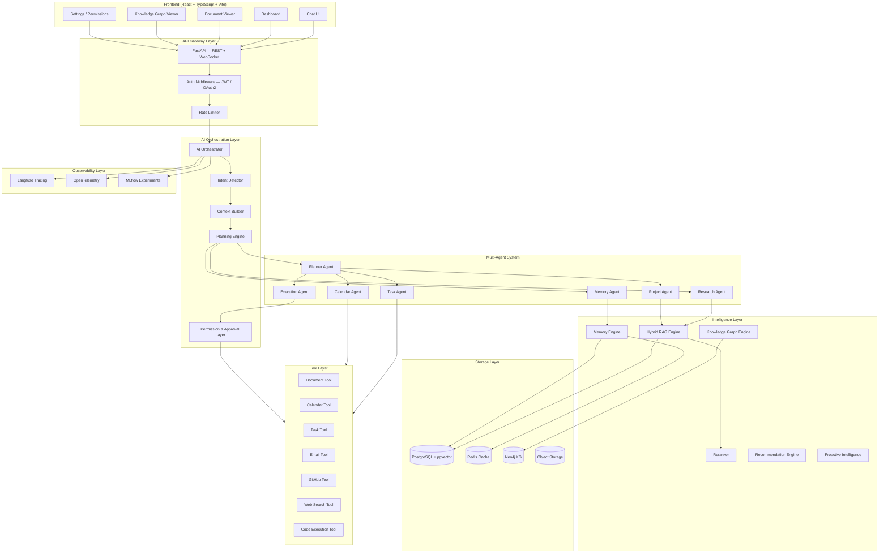
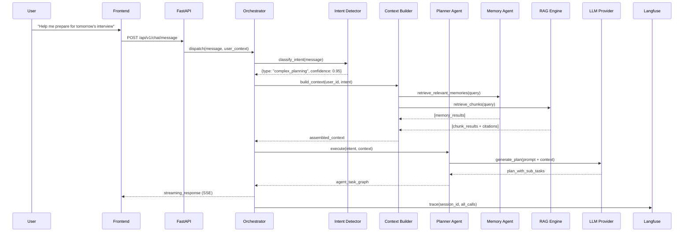
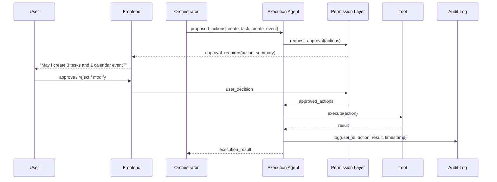

# 01 — System Architecture

## High-Level Architecture

---

## Layer Descriptions

### 1. Frontend Layer
- **Chat UI**: Conversational interface, streaming responses, citation display
- **Dashboard**: Goals, tasks, calendar, project overview with AI insights
- **Document Viewer**: Upload, view, annotated documents with AI summaries
- **Knowledge Graph Viewer**: Interactive graph visualization of entities/relationships
- **Settings / Permissions**: Manage integrations, data access, and action approvals

### 2. API Gateway Layer
- FastAPI with async handlers and WebSocket for streaming
- JWT-based authentication with OAuth2 for external integrations
- Request validation via Pydantic models
- Rate limiting per user and per endpoint

### 3. AI Orchestration Layer
- **AI Orchestrator**: Coordinates all AI components for a given user request
- **Intent Detector**: Classifies user intent (query, action, planning, reflection)
- **Context Builder**: Assembles relevant context from memory, KG, and RAG
- **Planning Engine**: Decomposes complex requests into agent task graphs
- **Permission Layer**: Requires explicit approval before mutating external state

### 4. Multi-Agent System
Seven specialized agents operate as a directed graph orchestrated by the Planner Agent.

### 5. Intelligence Layer
- **Hybrid RAG**: BM25 + dense vector retrieval with reranking
- **Memory Engine**: Manages 4 types of memory with selective consolidation
- **Knowledge Graph Engine**: Entity/relationship extraction and graph traversal
- **Recommendation Engine**: Surfaces proactive suggestions based on context
- **Proactive Intelligence**: Background monitoring and unprompted nudges

### 6. Storage Layer
| Store | Purpose |
|-------|---------|
| PostgreSQL | Relational data, document chunks, vector embeddings (pgvector) |
| Redis | Working memory, session cache, rate limiting, pub/sub |
| Neo4j | Knowledge graph — entities, relationships, traversal |
| Object Storage | Raw document files (local FS or S3-compatible) |

### 7. Tool Layer
Tools are callable functions with structured inputs/outputs, always permission-checked.

### 8. Observability Layer
- **Langfuse**: Full LLM call tracing, prompt versioning, cost tracking
- **OpenTelemetry**: Distributed traces across all services
- **MLflow**: Experiment tracking for model evaluation and fine-tuning

---

## Data Flow — Query Request

---

## Data Flow — Action Request (Permission-Gated)

---

## Cross-Cutting Concerns

| Concern | Implementation |
|---------|---------------|
| Prompt Injection | Input sanitization + system prompt hardening + output validation |
| PII Protection | Data classification at ingest + field-level encryption |
| Multi-tenancy | Row-level security in PostgreSQL, namespace isolation in Neo4j |
| Idempotency | Action IDs with deduplication keys |
| Retry Logic | Exponential backoff on LLM and tool calls |
| Circuit Breakers | Per-integration circuit breakers to prevent cascade failures |
