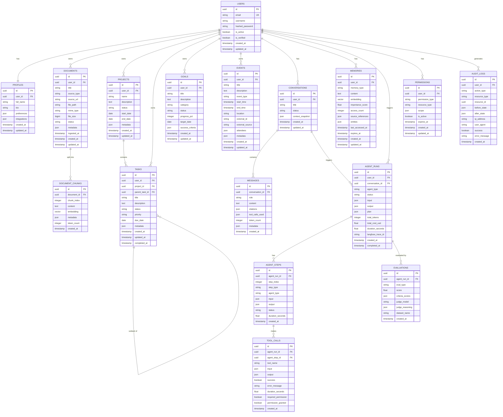

# 03 — Database Design

## ER Diagram



---

## Table Schemas (Detailed)

### `users`
| Column | Type | Constraints | Description |
|--------|------|-------------|-------------|
| id | UUID | PK, default gen_random_uuid() | |
| email | VARCHAR(255) | UNIQUE, NOT NULL | Login identifier |
| username | VARCHAR(50) | UNIQUE | Display name |
| hashed_password | VARCHAR(255) | NOT NULL | bcrypt hash |
| is_active | BOOLEAN | DEFAULT TRUE | Account enabled |
| is_verified | BOOLEAN | DEFAULT FALSE | Email verified |
| created_at | TIMESTAMPTZ | DEFAULT NOW() | |
| updated_at | TIMESTAMPTZ | | Updated via trigger |

### `document_chunks`
| Column | Type | Constraints | Description |
|--------|------|-------------|-------------|
| id | UUID | PK | |
| document_id | UUID | FK → documents.id, ON DELETE CASCADE | |
| chunk_index | INTEGER | NOT NULL | Position in document |
| content | TEXT | NOT NULL | Raw chunk text |
| embedding | VECTOR(1536) | | pgvector column |
| metadata | JSONB | | page, section, etc. |
| token_count | INTEGER | | Approx tokens |
| created_at | TIMESTAMPTZ | DEFAULT NOW() | |

**Indexes:**
```sql
CREATE INDEX ON document_chunks USING ivfflat (embedding vector_cosine_ops)
  WITH (lists = 100);
CREATE INDEX ON document_chunks (document_id);
CREATE INDEX ON document_chunks USING gin (metadata);
```

### `memories`
| Column | Type | Constraints | Description |
|--------|------|-------------|-------------|
| id | UUID | PK | |
| user_id | UUID | FK → users.id | |
| memory_type | VARCHAR(50) | CHECK IN ('semantic','episodic','procedural','working') | |
| content | TEXT | NOT NULL | |
| embedding | VECTOR(1536) | | For similarity search |
| importance_score | FLOAT | DEFAULT 0.5 | 0–1 scale |
| access_count | INTEGER | DEFAULT 0 | Used for decay |
| source_references | JSONB | | Links to documents, events |
| entities | JSONB | | Extracted named entities |
| last_accessed_at | TIMESTAMPTZ | | For LRU decay |
| expires_at | TIMESTAMPTZ | | NULL = permanent |
| created_at | TIMESTAMPTZ | DEFAULT NOW() | |
| updated_at | TIMESTAMPTZ | | |

**Indexes:**
```sql
CREATE INDEX ON memories USING ivfflat (embedding vector_cosine_ops)
  WITH (lists = 100);
CREATE INDEX ON memories (user_id, memory_type);
CREATE INDEX ON memories (importance_score DESC);
CREATE INDEX ON memories (expires_at) WHERE expires_at IS NOT NULL;
```

### `agent_runs`
Full record of every AI orchestration session for observability, debugging, and billing.

### `audit_logs`
Immutable append-only log of all state-changing operations. Critical for security and compliance.

---

## PostgreSQL Extensions Required

```sql
CREATE EXTENSION IF NOT EXISTS "pgcrypto";    -- gen_random_uuid()
CREATE EXTENSION IF NOT EXISTS "vector";       -- pgvector
CREATE EXTENSION IF NOT EXISTS "pg_trgm";      -- fuzzy text search (BM25 partial)
CREATE EXTENSION IF NOT EXISTS "btree_gin";    -- Composite GIN indexes
```

---

## Data Retention Policy

| Table | Retention | Policy |
|-------|-----------|--------|
| audit_logs | 7 years | Immutable, partitioned by year |
| agent_runs | 1 year | Compressed after 90 days |
| agent_steps | 90 days | Linked to agent_runs |
| working memory | Session | Expires on conversation close |
| episodic memory | 2 years | Decay via importance_score |
| tool_calls | 90 days | |
| messages | Indefinite | User-controlled deletion |
