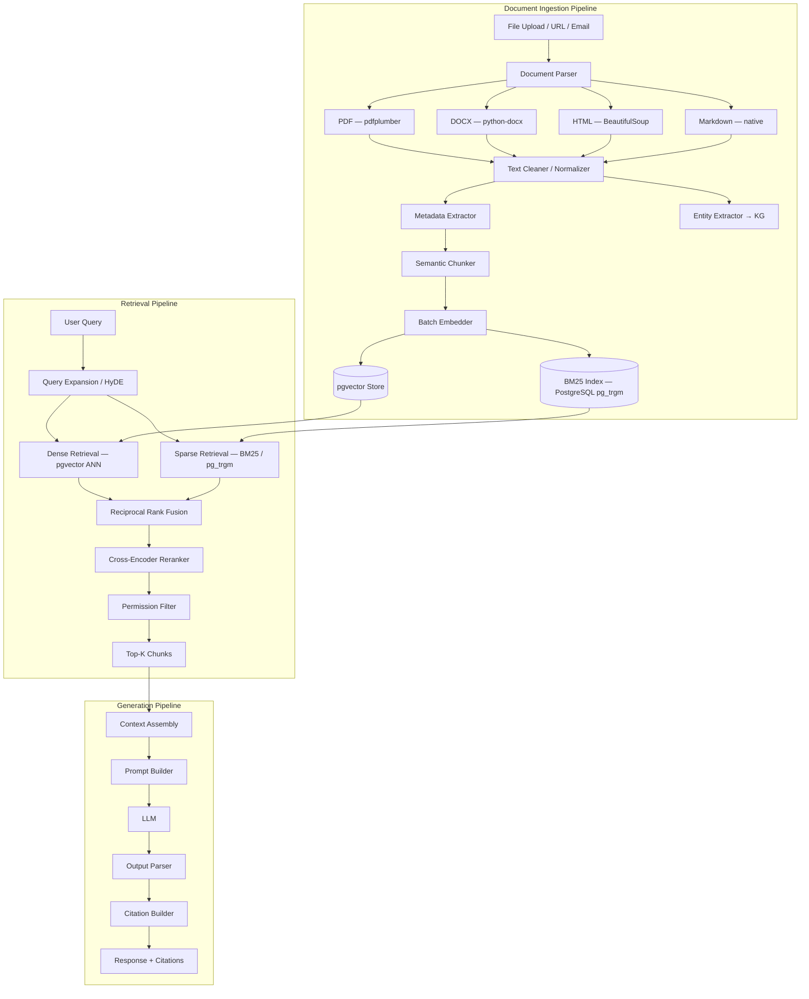
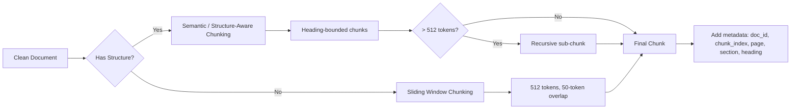
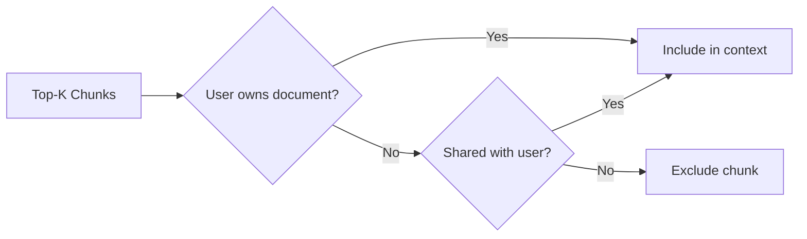
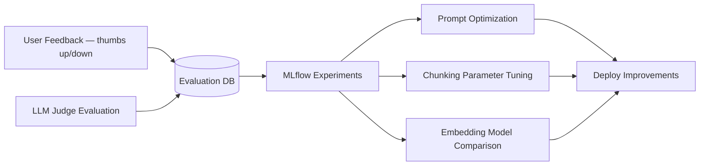

# 05 — RAG Architecture

## Overview

NEXUS uses **Hybrid RAG** — combining sparse (BM25) and dense (vector) retrieval with
cross-encoder reranking and structured citation generation.

---

## Full RAG Pipeline



---

## Document Ingestion (Detailed)

### Supported Document Types

| Type | Parser | Notes |
|------|--------|-------|
| PDF | pdfplumber + PyMuPDF fallback | OCR via pytesseract for scanned PDFs |
| DOCX | python-docx | Preserves headings for structure-aware chunking |
| HTML / Web | BeautifulSoup | Strips nav/footer, extracts main content |
| Markdown | Native | Heading-aware chunking |
| Plain Text | Native | Paragraph-based chunking |
| Email | email stdlib | Subject + body + attachments |
| GitHub | PyGitHub API | README, code files, commit messages |
| Calendar | ics / Google API | Event text extraction |

### Chunking Strategy



**Chunking parameters:**
```python
CHUNK_SIZE = 512          # tokens
CHUNK_OVERLAP = 50        # tokens
MIN_CHUNK_SIZE = 50       # tokens — discard smaller
MAX_CHUNKS_PER_DOC = 1000
```

### Embedding

- **Model**: Configurable (default: `text-embedding-3-small`, 1536 dims)
- **Batch size**: 100 chunks per API call
- **Storage**: pgvector column in `document_chunks`
- **Index**: IVFFlat with `lists = sqrt(num_rows)`

---

## Retrieval Pipeline (Detailed)

### Query Expansion / HyDE

Before retrieval, the query is optionally expanded using two strategies:

1. **HyDE (Hypothetical Document Embeddings)**: LLM generates a hypothetical answer;
   that answer is embedded and used for retrieval alongside the original query.
2. **Keyword Expansion**: Extract key terms using NLP for BM25 boosting.

```python
# HyDE example
hypothetical_doc = await llm.chat([
    {"role": "user", "content": f"Write a brief answer to: {query}"}
])
hyde_embedding = await embedder.embed(hypothetical_doc)
# Retrieval uses average of query_embedding and hyde_embedding
```

### Dense Retrieval (pgvector)

```sql
SELECT id, content, metadata,
       1 - (embedding <=> $1::vector) AS similarity
FROM document_chunks
WHERE user_id = $2
ORDER BY embedding <=> $1::vector
LIMIT 50;
```

### Sparse Retrieval (BM25 via pg_trgm)

```sql
SELECT id, content, metadata,
       ts_rank(to_tsvector('english', content), query) AS rank
FROM document_chunks, plainto_tsquery('english', $1) AS query
WHERE user_id = $2
  AND to_tsvector('english', content) @@ query
ORDER BY rank DESC
LIMIT 50;
```

### Reciprocal Rank Fusion

```python
def reciprocal_rank_fusion(
    dense_results: list[Chunk],
    sparse_results: list[Chunk],
    k: int = 60,
) -> list[Chunk]:
    scores = {}
    for i, chunk in enumerate(dense_results):
        scores[chunk.id] = scores.get(chunk.id, 0) + 1 / (k + i + 1)
    for i, chunk in enumerate(sparse_results):
        scores[chunk.id] = scores.get(chunk.id, 0) + 1 / (k + i + 1)
    return sorted(all_chunks, key=lambda c: scores[c.id], reverse=True)
```

### Reranking

```python
# Cohere Rerank (cloud)
reranked = cohere_client.rerank(
    query=query,
    documents=[c.content for c in fused_chunks],
    model="rerank-english-v3.0",
    top_n=10,
)

# Local fallback: cross-encoder/ms-marco-MiniLM-L-6-v2
```

---

## Citation Generation

Every RAG response includes structured citations:

```json
{
  "response": "Your resume highlights 5 years of Python experience...",
  "citations": [
    {
      "citation_id": "c1",
      "document_title": "resume_2025.pdf",
      "document_id": "uuid-...",
      "chunk_id": "uuid-...",
      "page": 1,
      "section": "Experience",
      "excerpt": "5+ years of Python development...",
      "relevance_score": 0.94
    }
  ]
}
```

Citations appear inline in responses: `[1]`, `[2]`, etc., linked to the source document.

---

## Permission-Aware Retrieval

Before returning results, chunks are filtered by the user's data permissions:



---

## RAG Quality Metrics

| Metric | Target | Measurement |
|--------|--------|-------------|
| Retrieval Precision@10 | > 0.80 | Evaluation dataset |
| Retrieval Recall@10 | > 0.75 | Evaluation dataset |
| NDCG@10 | > 0.85 | Evaluation dataset |
| Answer Faithfulness | > 0.90 | LLM-as-judge |
| Answer Relevance | > 0.85 | LLM-as-judge |
| Context Precision | > 0.80 | LLM-as-judge |
| Latency P95 | < 3000ms | OpenTelemetry |

---

## Continuous Improvement Loop


