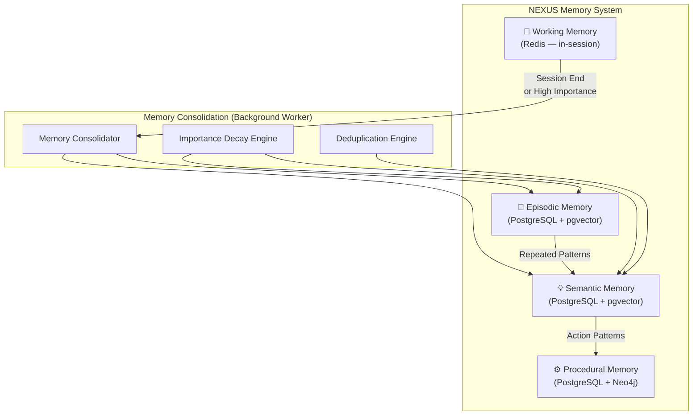
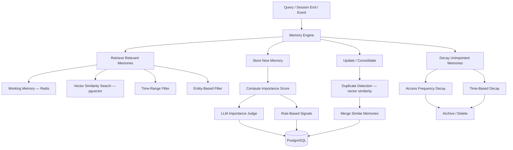
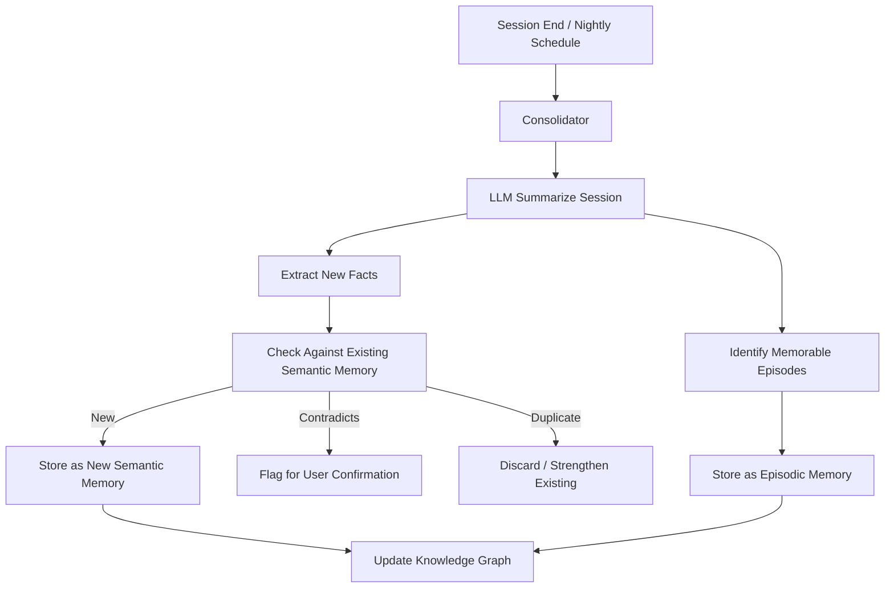

# 06 — Memory Architecture

## Overview

NEXUS implements four complementary memory types inspired by human cognitive memory systems.
Together they allow NEXUS to maintain context across sessions, remember user preferences,
recall past events, and retain procedural knowledge about how to perform tasks.

---

## Memory Type Overview



---

## 1. Working Memory

**Purpose**: Short-term, in-session context. Ephemeral and fast.

**Storage**: Redis (TTL-based expiry)

**Contents per session:**
- Current conversation history (last N messages)
- Active agent task graph
- Pending permission requests
- Retrieved RAG chunks for current turn
- Intermediate reasoning steps

**Schema (Redis Hash):**
```
session:{user_id}:{conversation_id}
  ├── messages: [JSON list of recent messages]
  ├── active_agents: [list of running agent IDs]
  ├── context_chunks: [list of RAG chunk IDs]
  ├── pending_actions: [list of proposed actions]
  └── session_metadata: {intent, started_at, ...}
```

**TTL**: 24 hours after last activity (configurable)

**Capacity limits:**
```python
MAX_MESSAGES_IN_WM = 50
MAX_CHUNKS_IN_WM = 20
MAX_WM_SIZE_BYTES = 1_048_576  # 1 MB per session
```

---

## 2. Episodic Memory

**Purpose**: "What happened" — records of past sessions, conversations, events, and
user experiences. Time-indexed, narrative in nature.

**Storage**: PostgreSQL `memories` table (memory_type = 'episodic') + pgvector

**Lifetime**: 2 years (with decay; important ones persist longer)

**Example entries:**
```json
{
  "memory_type": "episodic",
  "content": "On 2026-09-15, user had a technical interview at Acme Corp for a Senior ML Engineer role. They felt confident about Python questions but struggled with system design.",
  "importance_score": 0.85,
  "source_references": {
    "conversation_id": "uuid-...",
    "event_id": "uuid-..."
  },
  "entities": ["Acme Corp", "Senior ML Engineer", "Python", "system design"]
}
```

**Retrieval**:
- Semantic similarity search (pgvector) for relevant past episodes
- Time-range filtering (recent episodes weighted higher)
- Importance score filtering (score > 0.3)

---

## 3. Semantic Memory

**Purpose**: "What is known" — distilled facts about the user, their world, skills,
preferences, and beliefs. Timeless, factual.

**Storage**: PostgreSQL `memories` table (memory_type = 'semantic') + pgvector

**Lifetime**: Indefinite (updated when contradicted)

**Example entries:**
```json
{
  "memory_type": "semantic",
  "content": "User is proficient in Python, SQL, and TypeScript. Intermediate in Go.",
  "importance_score": 0.9,
  "entities": ["Python", "SQL", "TypeScript", "Go"]
}

{
  "memory_type": "semantic",
  "content": "User prefers morning meetings between 9am and 11am.",
  "importance_score": 0.7
}

{
  "memory_type": "semantic",
  "content": "User's long-term goal is to become a Staff Engineer by 2028.",
  "importance_score": 0.95
}
```

**Update strategy**: Contradiction detection — if new information conflicts with existing
semantic memory, flag for user confirmation and update.

---

## 4. Procedural Memory

**Purpose**: "How to do things" — knowledge about workflows, user preferences for
task execution, successful action patterns.

**Storage**: PostgreSQL `memories` table (memory_type = 'procedural') + Neo4j (action graph)

**Lifetime**: Indefinite

**Example entries:**
```json
{
  "memory_type": "procedural",
  "content": "When scheduling a focus session, user prefers 90-minute blocks with a 15-minute buffer after. Add to 'Deep Work' calendar, not primary.",
  "importance_score": 0.8
}
```

---

## Memory Engine

The Memory Engine is the central coordinator for all memory operations.



---

## Memory Retrieval Strategy

```mermaid
flowchart LR
    Query[User Query] --> Embed[Embed Query]
    Embed --> WM_Check[Check Working Memory — instant]
    WM_Check --> VecQuery[Vector Search — pgvector]
    VecQuery --> EntitySearch[Entity-Filtered Search]
    EntitySearch --> TimeWeight[Recency Weighting]
    TimeWeight --> ImportWeight[Importance Weighting]
    ImportWeight --> Dedup[De-duplicate]
    Dedup --> Top20[Top-20 Memories]
    Top20 --> CtxBuild[Context Builder]
```



**Scoring formula:**
```
final_score = (similarity * 0.4) + (importance * 0.3) + (recency * 0.2) + (access_freq * 0.1)
```

---

## Memory Consolidation (Background Worker)

Runs after each conversation ends and on a nightly schedule:



---

## Memory Importance Scoring

Importance is computed by combining rule-based signals and an LLM judge:

| Signal | Weight | Description |
|--------|--------|-------------|
| User explicitly saved | +0.5 | User marked as important |
| User returned to topic | +0.2 | Multiple sessions on same topic |
| Related to active goal | +0.3 | Linked to a current user goal |
| Emotional salience | +0.1 | LLM detects significant event |
| Time decay (30 days) | -0.05/mo | Reduces unless accessed |
| Frequently accessed | +0.02/access | Access bump (max +0.3) |

---

## Memory Limits & Quotas

| Memory Type | Soft Limit | Hard Limit | Eviction |
|-------------|-----------|-----------|---------|
| Working Memory | 1 MB/session | 2 MB | LRU |
| Episodic Memory | 5,000 entries | 10,000 | Decay-based |
| Semantic Memory | 2,000 entries | 5,000 | Contradiction merge |
| Procedural Memory | 500 entries | 1,000 | LRU |
