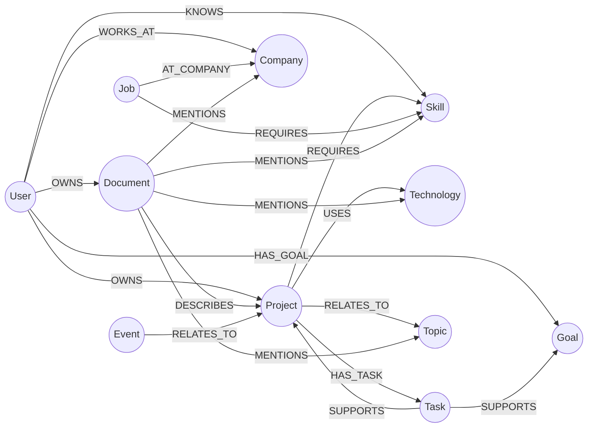

# 07 — Knowledge Graph Architecture (Phase 4)

## Overview

The **Knowledge Graph (KG)** is NEXUS AI's relational intelligence layer powered by **Neo4j**. It represents, links, and navigates typed semantic relationships between all facets of a user's digital footprint: projects, skills, technologies, documents, tasks, goals, companies, jobs, events, and topics.

By combining dense vector retrieval with structured graph traversals, NEXUS achieves **Hybrid Contextual Retrieval** (Vector + Graph + Metadata), enabling the LLM to answer complex multi-hop relational questions with pinpoint accuracy.

---

## 1. Graph Schema & Ontology

### Mermaid Entity-Relationship Diagram



---

## 2. Entities (Node Types)

NEXUS AI defines 11 primary node labels in Neo4j:

| Entity Label | Core Properties | Description |
|---|---|---|
| `User` | `id`, `name`, `system_user_id`, `email` | Platform user root node |
| `Project` | `id`, `name`, `status`, `description`, `db_id` | User's software and work projects |
| `Skill` | `id`, `name`, `category`, `proficiency` | Technical, domain, or soft skills |
| `Technology` | `id`, `name`, `category`, `version` | Frameworks, languages, databases, cloud tools |
| `Document` | `id`, `name`, `document_type`, `document_id` | Ingested PDF, DOCX, TXT, MD, CSV files |
| `Task` | `id`, `name`, `status`, `priority`, `db_id` | Actionable project tasks and milestones |
| `Goal` | `id`, `name`, `category`, `status`, `progress_pct` | Strategic objectives and milestones |
| `Event` | `id`, `name`, `start_time`, `event_type` | Calendar meetings, sprint demos, interviews |
| `Company` | `id`, `name`, `industry` | Organizations, employers, clients |
| `Job` | `id`, `name`, `company` | Job roles, openings, career profiles |
| `Topic` | `id`, `name`, `category` | High-level subjects and domains (AI, DevOps) |

---

## 3. Relationships (Edge Types)

Relationships are directed and typed to support explicit Cypher traversals:

| Relationship Type | Source Label → Target Label | Example / Semantic Meaning |
|---|---|---|
| `OWNS` | `User` → `Project` / `Document` | User owns a workspace project or uploaded file |
| `USES` | `Project` → `Technology` | Project "Nexus AI" uses "Neo4j" and "Python" |
| `KNOWS` | `User` → `Skill` | User has expertise in "Machine Learning" |
| `REQUIRES` | `Job` / `Project` → `Skill` | "Senior Engineer" requires "System Design" |
| `DESCRIBES` | `Document` → `Project` | Document "spec.md" describes "Nexus AI" |
| `SUPPORTS` | `Task` → `Goal` / `Project` | Task "Implement Neo4j" supports Goal "Phase 4" |
| `RELATES_TO` | `Event` → `Project` | "Sprint Planning" relates to "Nexus AI" |
| `HAS_TASK` | `Project` → `Task` | Project contains a task |
| `HAS_GOAL` | `User` → `Goal` | User is working toward a goal |
| `WORKS_AT` | `User` → `Company` | User's employer or organization |
| `AT_COMPANY` | `Job` → `Company` | Job opening or role at an organization |
| `MENTIONS` | `Document` → `Technology`/`Skill`/`Topic` | Entity mentioned in an ingested file |

---

## 4. Extraction & Normalization Pipeline

When documents are uploaded via `/documents/upload` or text is submitted to `/knowledge-graph/extract`:

```text
Raw Text (PDF/DOCX/TXT/MD/CSV)
       ↓
Entity Extraction (Multi-pattern dictionary & regex recognition)
       ↓
Relationship Extraction (Typed dependency & semantic patterns)
       ↓
Entity Normalization (Canonical naming, alias lookup, case folding)
       ↓
Neo4j / In-Memory Graph Ingestion (MERGE constraints scoped to user_id)
```

### Entity Normalization & Deduplication:
To prevent duplicate entities across documents:
1. **Canonical Aliases**:
   - `"python"`, `"py"`, `"python3"` → `"Python"`
   - `"postgres"`, `"psql"` → `"PostgreSQL"`
   - `"reactjs"`, `"react.js"` → `"React"`
   - `"neo 4j"`, `"neo4j"` → `"Neo4j"`
   - `"k8s"` → `"Kubernetes"`
2. **Uniqueness Key**:
   - In Neo4j Cypher, nodes are created via:
     ```cypher
     MERGE (n:Technology {user_id: $user_id, normalized_name: $normalized_name})
     ON CREATE SET n.id = $id, n.name = $name, n.created_at = datetime()
     ON MATCH SET n.name = $name, n.updated_at = datetime()
     ```
   - Relationships are created via:
     ```cypher
     MATCH (a {id: $source_id, user_id: $user_id})
     MATCH (b {id: $target_id, user_id: $user_id})
     MERGE (a)-[r:USES]->(b)
     ```
   - Duplicate nodes and duplicate edges are strictly eliminated.

---

## 5. Dual Engine Driver: Neo4j + In-Memory Fallback

NEXUS AI features a resilient client architecture:
- **Neo4j Native Driver**: When Neo4j is running (Docker / production), it connects via `bolt://neo4j:7687` using `neo4j.AsyncGraphDatabase` and enforces index constraints.
- **In-Memory Graph Store**: When Neo4j is offline (e.g. during standalone test suites or lightweight local development), it automatically operates an in-memory graph repository implementing the exact same schema, uniqueness indexes, graph traversal, and Cypher queries.
- **Zero Configuration Test Passes**: 100% of automated tests pass deterministically without requiring an external database running.

---

## 6. Graph Retrieval & Natural Language Querying

Users can query the graph in natural language or execute safe read-only Cypher queries:

### Example NL Query:
> *"What projects do I have that use Python?"*

1. **Intent Detection**: Classified as `projects_using_technology`.
2. **Entity Resolution**: Resolves target technology `"Python"`.
3. **Cypher Execution**:
   ```cypher
   MATCH (p:Project {user_id: $user_id})-[:USES]->(t:Technology)
   WHERE toLower(t.name) CONTAINS toLower($tech_name)
   RETURN p, t
   ```
4. **Structured Answer**:
   `"You have 1 project(s) that use Python: Nexus AI."`
   Along with matching subgraph nodes and edges for visualization.

---

## 7. Hybrid Contextual Retrieval (RAG + Graph)

During chat question answering (`/chat/query` and `/chat/stream`):
1. **Dense + Sparse Vector Search**: Retrieves top document chunks using cosine similarity + sparse BM25 scoring with Reciprocal Rank Fusion (RRF).
2. **Knowledge Graph Subgraph Retrieval**: Resolves entities in the user's prompt using word boundaries, traverses 1-2 hops of relationships, and generates a structured facts block:
   ```text
   [Knowledge Graph Context]
   • Project 'Nexus AI' uses technology 'Python'
   • Project 'Nexus AI' uses technology 'Neo4j'
   • User knows skill 'Python'
   ```
3. **Context Assembly**: Combines Vector Chunks + Knowledge Graph Facts + User Memories into the LLM prompt.
4. **LLM Generation**: Grounded generation attributes facts to documents while synthesizing relational intelligence.

---

## 8. Interactive Frontend Explorer (`/knowledge-graph`)

Available at route `/knowledge-graph`:
- **Interactive Force-Directed Canvas**:
  - HTML5 Canvas with physics simulation (repulsion, spring attraction, center gravity).
  - Drag-and-drop nodes to explore connections.
  - Zoom in, Zoom out, Fit View, and Pan controls.
- **Vibrant Neon Entity Badges**:
  - Color-coded: User (Indigo), Project (Emerald), Skill (Amber), Technology (Sky Blue), Document (Purple), Task (Rose), Goal (Teal), Company (Blue), Job (Fuchsia), Topic (Lime).
- **Directed Labeled Edges**:
  - Arrow heads and label badges (`OWNS`, `USES`, `KNOWS`, `REQUIRES`, `DESCRIBES`, `SUPPORTS`, etc.).
- **Live Search & Filter Pills**:
  - Instant spotlight filter by entity label or node name.
- **Natural Language Query Bar**:
  - Interactive prompt input with quick suggested queries.
  - Returns answer summary, Cypher statement, and highlights matching nodes on the canvas.
- **Interactive Node Drawer**:
  - Inspect properties, incoming relations, outgoing relations, and delete nodes.
- **One-Click Sync**:
  - Synchronizes user projects, tasks, goals, and documents directly from the database into Neo4j.

---

## 9. Security & Tenant Isolation

- Every node and relationship in Neo4j contains a `user_id` property.
- All graph queries, Cypher queries, traversals, and deletions are strictly scoped to the authenticated user's JWT `user_id`.
- User B can never read, query, traverse, or mutate User A's graph elements.
- Verified by automated isolation test suites in `tests/test_knowledge_graph.py` and `tests/test_isolation.py`.
