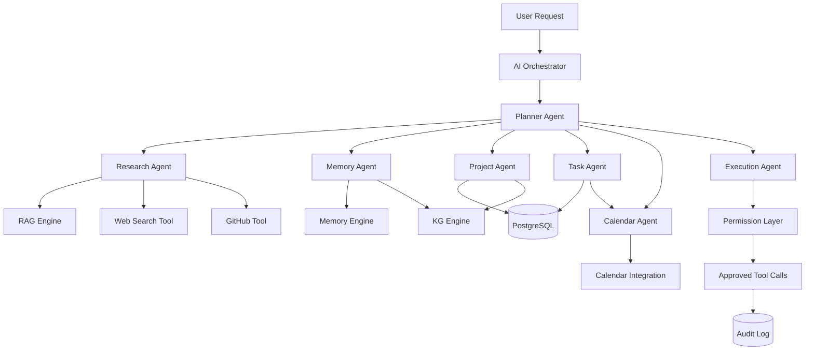
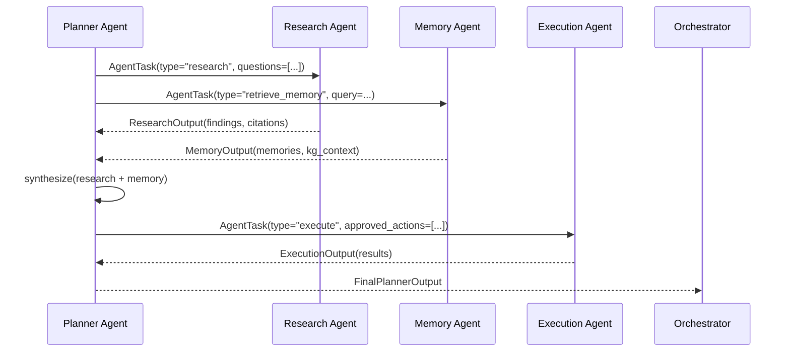
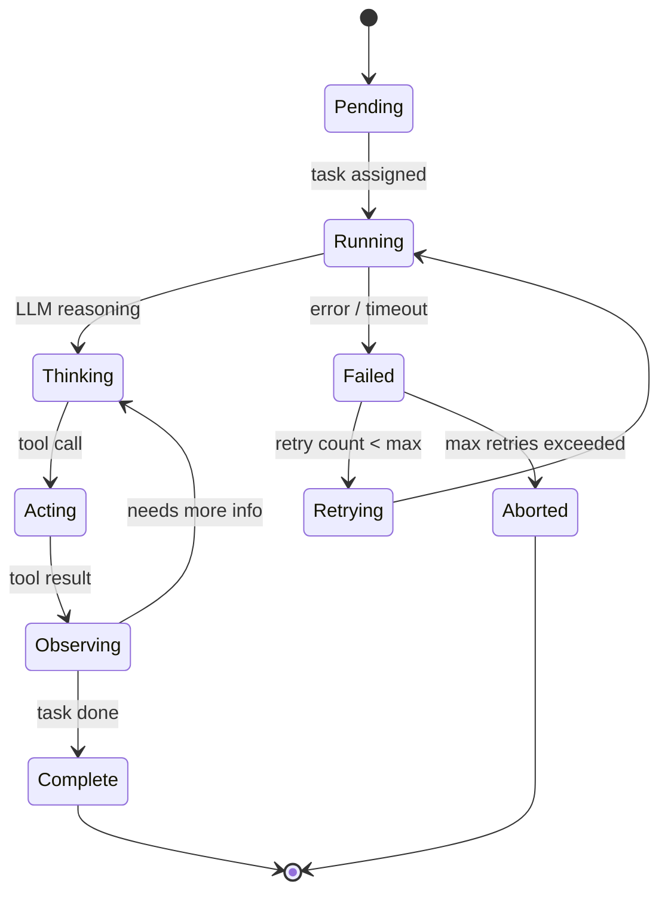

# 08 — Agent Architecture

## Overview

NEXUS uses a **hierarchical multi-agent system** where a Planner Agent orchestrates
specialized sub-agents. Each agent has defined responsibilities, inputs, outputs,
tools, dependencies, and failure handling.

---

## Agent Orchestration Architecture



---

## Base Agent Interface

```python
class BaseAgent(ABC):
    name: str
    description: str
    tools: list[BaseTool]
    llm: BaseLLMProvider
    memory: MemoryEngine
    max_iterations: int = 10

    @abstractmethod
    async def run(self, task: AgentTask) -> AgentResult:
        ...

    async def _think(self, prompt: str, context: dict) -> str:
        """Generate reasoning step"""
        ...

    async def _act(self, tool_name: str, tool_input: dict) -> ToolResult:
        """Execute a tool call"""
        ...

    async def _observe(self, tool_result: ToolResult) -> str:
        """Process tool result and update reasoning"""
        ...
```

---

## Agent 1: Planner Agent

**Role**: Master orchestrator. Decomposes complex user intents into a directed task graph
and delegates to specialized agents.

**Responsibilities:**
- Interpret complex, multi-step user requests
- Create a dependency-ordered agent task graph
- Monitor sub-agent progress and handle failures
- Synthesize final response from all agent outputs
- Determine if permission is needed before proceeding

**Inputs:**
```python
class PlannerInput(BaseModel):
    user_message: str
    intent: Intent
    context: AssembledContext
    conversation_history: list[Message]
```

**Outputs:**
```python
class PlannerOutput(BaseModel):
    plan: list[AgentTask]          # Ordered task graph
    reasoning: str                  # Chain-of-thought
    requires_permission: bool
    proposed_actions: list[ProposedAction]
    final_response: str | None      # If plan is complete
```

**Tools:** None (delegates to sub-agents)

**Dependencies:** All other agents

**Failure Handling:**
- Sub-agent timeout → mark task as failed, continue with available results
- Sub-agent error → retry once, then use partial results
- All agents fail → fall back to direct LLM response with available context

---

## Agent 2: Research Agent

**Role**: Information retrieval and synthesis specialist.

**Responsibilities:**
- Execute hybrid RAG searches across user documents
- Search the web for external information
- Query GitHub repositories for code context
- Synthesize and summarize retrieved information
- Build citations for all retrieved facts

**Inputs:**
```python
class ResearchInput(BaseModel):
    research_questions: list[str]
    search_scope: list[str]        # ["documents", "web", "github"]
    user_id: UUID
    max_results_per_source: int = 10
```

**Outputs:**
```python
class ResearchOutput(BaseModel):
    findings: list[Finding]
    citations: list[Citation]
    synthesis: str
    confidence_score: float
```

**Tools:**
- `document_search_tool` — hybrid RAG search
- `web_search_tool` — DuckDuckGo / Bing API
- `github_search_tool` — repo, code, and commit search

**Dependencies:** RAG Engine, Memory Engine (for past research)

**Failure Handling:**
- RAG failure → attempt memory-only lookup
- Web search failure → continue with document results
- No results found → return empty findings with explanation

---

## Agent 3: Memory Agent

**Role**: Memory retrieval, storage, and knowledge graph management.

**Responsibilities:**
- Retrieve relevant memories for current context
- Store new episodic memories from sessions
- Extract and update semantic facts
- Update knowledge graph with new entities/relationships
- Detect memory contradictions and flag for resolution

**Inputs:**
```python
class MemoryInput(BaseModel):
    query: str
    user_id: UUID
    memory_types: list[str]        # ['semantic', 'episodic', 'procedural']
    operation: str                  # 'retrieve' | 'store' | 'consolidate'
    content_to_store: str | None
```

**Outputs:**
```python
class MemoryOutput(BaseModel):
    retrieved_memories: list[Memory]
    stored_memory_ids: list[UUID]
    kg_updates: list[KGUpdate]
    contradictions: list[Contradiction]
```

**Tools:**
- `memory_search_tool` — pgvector similarity search
- `kg_query_tool` — read-only Cypher queries
- `memory_store_tool` — write to memory table
- `kg_update_tool` — write to Neo4j (permission-checked)

**Failure Handling:**
- Memory DB failure → continue with working memory only
- KG failure → log error, return memory results without KG context

---

## Agent 4: Project Agent

**Role**: Project intelligence and context specialist.

**Responsibilities:**
- Retrieve project details, tasks, and milestones
- Assess project health and progress
- Find relevant projects for a given context
- Identify project dependencies and blockers
- Suggest project-related actions

**Inputs:**
```python
class ProjectInput(BaseModel):
    user_id: UUID
    query: str
    project_ids: list[UUID] | None    # If specific projects needed
    include_tasks: bool = True
    include_related_docs: bool = True
```

**Outputs:**
```python
class ProjectOutput(BaseModel):
    projects: list[ProjectSummary]
    relevant_tasks: list[Task]
    health_assessment: dict
    recommendations: list[str]
    related_documents: list[Document]
```

**Tools:**
- `project_query_tool` — query PostgreSQL projects/tasks
- `document_search_tool` — find project-related documents
- `kg_query_tool` — find project relationships in KG

**Failure Handling:**
- DB query failure → return cached project data from working memory

---

## Agent 5: Task Agent

**Role**: Task creation, management, and scheduling specialist.

**Responsibilities:**
- Create new tasks from user requests or agent plans
- Update task status and details
- Break down complex goals into actionable tasks
- Estimate task durations and assign priorities
- Identify task dependencies

**Inputs:**
```python
class TaskInput(BaseModel):
    user_id: UUID
    operation: str                  # 'create' | 'update' | 'list' | 'prioritize'
    task_data: dict
    project_id: UUID | None
    parent_task_id: UUID | None
```

**Outputs:**
```python
class TaskOutput(BaseModel):
    tasks: list[Task]
    created_task_ids: list[UUID]
    updated_task_ids: list[UUID]
    priority_order: list[UUID]
    time_estimates: dict[UUID, int]  # minutes
```

**Tools:**
- `task_create_tool` *(requires permission)*
- `task_update_tool` *(requires permission)*
- `task_query_tool`
- `calendar_availability_tool`

**Failure Handling:**
- Creation failure → retry once, then surface error to user with draft
- Validation error → return structured error with correction suggestions

---

## Agent 6: Calendar Agent

**Role**: Calendar intelligence and scheduling specialist.

**Responsibilities:**
- Find available time slots
- Schedule events (with permission)
- Retrieve upcoming events for context
- Identify scheduling conflicts
- Suggest optimal meeting times based on preferences

**Inputs:**
```python
class CalendarInput(BaseModel):
    user_id: UUID
    operation: str                  # 'find_slots' | 'create_event' | 'list_events'
    time_range: DateTimeRange
    event_data: dict | None
    preferences: dict | None        # e.g., {"prefer_morning": True}
```

**Outputs:**
```python
class CalendarOutput(BaseModel):
    events: list[Event]
    available_slots: list[TimeSlot]
    created_event_ids: list[UUID]
    conflicts: list[Conflict]
```

**Tools:**
- `calendar_query_tool` — list events from PostgreSQL + external calendar
- `calendar_create_tool` *(requires permission)*
- `calendar_update_tool` *(requires permission)*
- `google_calendar_tool` *(requires OAuth2)*

**Failure Handling:**
- External calendar unavailable → use locally-synced events
- OAuth token expired → prompt user to re-authenticate

---

## Agent 7: Execution Agent

**Role**: Safely executes approved external actions.

**Responsibilities:**
- Execute only permission-approved actions
- Handle tool call errors gracefully
- Roll back partial executions on failure
- Log all actions to audit log
- Report execution results

**Inputs:**
```python
class ExecutionInput(BaseModel):
    approved_actions: list[ApprovedAction]
    user_id: UUID
    conversation_id: UUID
```

**Outputs:**
```python
class ExecutionOutput(BaseModel):
    executed_actions: list[ExecutedAction]
    failed_actions: list[FailedAction]
    rollback_performed: bool
    audit_log_ids: list[UUID]
```

**Tools:**
- All tools (only executes pre-approved ones)
- `audit_log_tool` — always called after every action

**Failure Handling:**
- Action failure → attempt rollback if reversible
- Partial execution → report completed actions, request user decision on remainder
- Critical failure → full rollback, alert user, do not retry automatically

---

## Agent Communication Protocol



---

## Agent State Machine



---

## Inter-Agent Message Format

```python
class AgentTask(BaseModel):
    task_id: UUID
    parent_task_id: UUID | None
    assigned_to: AgentType
    priority: int                   # 0 (highest) to 10
    input: dict
    timeout_seconds: int = 60
    retry_limit: int = 2
    context: dict                   # shared context from planner

class AgentResult(BaseModel):
    task_id: UUID
    agent_type: AgentType
    status: Literal["complete", "failed", "partial"]
    output: dict
    error: str | None
    reasoning_trace: list[str]
    tool_calls_made: list[ToolCall]
    duration_seconds: float
    token_usage: TokenUsage
```

---

## Phase 5 Multi-Agent Implementation

### 1. Implemented Agents

| Agent | Responsibility | Core Method / Schema |
| :--- | :--- | :--- |
| **Planner Agent** | Decomposes high-level requests into ordered, structured subtasks and required agent set | `PlannerOutput` (subtasks, required_agents, intent, goal) |
| **Research Agent** | Multi-source investigation across personal documents, RAG, Knowledge Graph, and approved external resources | `ResearchEvidence` (facts, documents, graph_entities, citations) |
| **Memory Agent** | Selective memory recall using strict semantic relevance and importance thresholds | `MemoryRecallOutput` (memories, retrieved_count, total_evaluated) |
| **Project Agent** | Analyzes user's repositories; matches projects to skills, job requirements, active goals, and tasks | `ProjectAnalysisOutput` (matched_projects, identified_gaps, focus) |
| **Task Agent** | Converts execution plans and interview preparation topics into prioritized task items | `TaskPlanOutput` (tasks with priority, due_date_offset, category) |
| **Calendar Agent** | Schedules time-boxed preparation sessions, mock screening blocks, and interview milestones | `CalendarAgentOutput` (events with offset_hours, duration, type) |
| **Execution Agent** | Dispatches concrete actions (persisting generated tasks into database, managing approvals) | `ExecutionAgentOutput` (actions, success status, summary) |

### 2. Central Orchestration Flow

```
User Request
    ↓
Intent Detection (Interview Prep, Project Planning, Task Generation, Research)
    ↓
Planner Agent (8-step decomposition for interview prep)
    ↓
Required Agents Resolution
    ↓
Context Builder (aggregates documents, graph context, user profile)
    ↓
Agent Execution (BaseAgent run loop with retry & fallback)
    ↓
Result Validation (Pydantic schema validation & completeness check)
    ↓
Final Response (Executive synthesis with STAR stories, timeline, & tasks)
```

### 3. Agent State Tracking & Failure Handling

Each agent run is wrapped with isolated state tracking:
- **Run ID**: Unique UUID per orchestration workflow
- **Status Lifecycle**: `PENDING` → `RUNNING` → `COMPLETED` (or `RETRIED` / `FAILED`)
- **Fault Tolerance**: Up to 2 retries with exponential backoff on exceptions
- **Safe Fallback**: Agent invokes `_fallback()` to supply graceful degraded output rather than crashing the system
- **UI Safety**: Exposes only high-level activity labels (`Planning...`, `Retrieving information...`, `Analyzing projects...`, `Checking memory...`, `Creating plan...`) without chain-of-thought leakage.

### 4. REST API Endpoints

- `POST /agents/orchestrate` (`/api/v1/agents/orchestrate`): Full multi-agent orchestration execution
- `GET /agents/runs/{run_id}` (`/api/v1/agents/runs/{run_id}`): Detailed execution audit and agent state history
- `GET /agents/definitions` (`/api/v1/agents/definitions`): Metadata and capabilities for all 7 registered agents
- `POST /chat/stream`: Real-time Server-Sent Events (SSE) with streaming activity pills and response synthesis

