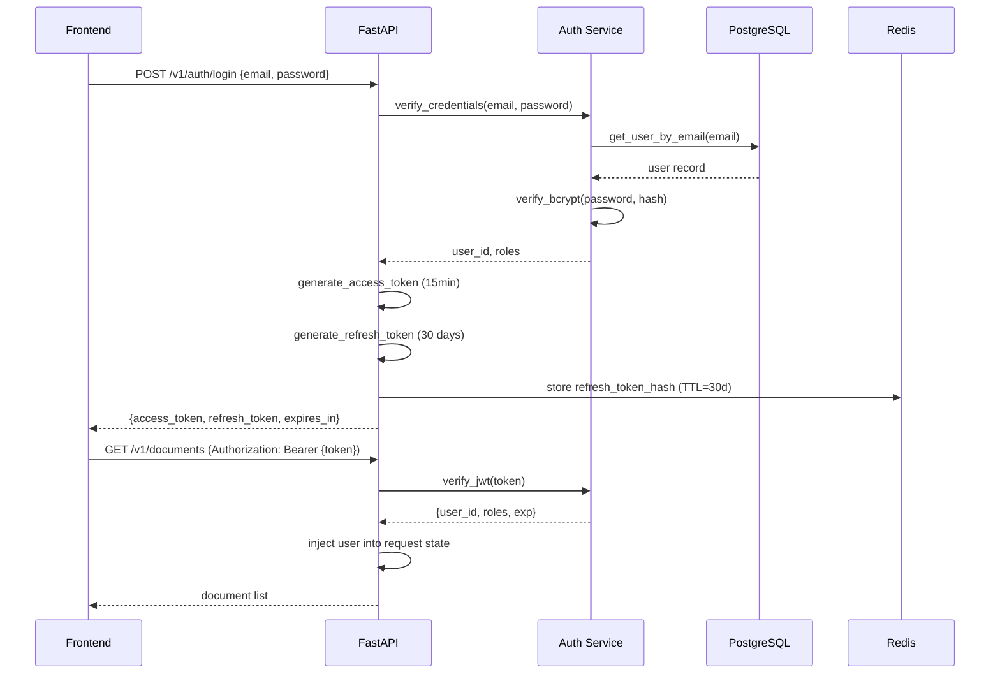

# 09 — API Architecture

## Overview

NEXUS exposes a versioned REST API with WebSocket / SSE support for streaming responses.
The API is built with FastAPI and auto-generates OpenAPI 3.1 documentation.

---

## API Structure

```
/api
  /health                     — Health check
  /v1
    /auth                     — Authentication
    /users                    — User management
    /chat                     — Conversational AI
    /documents                — Document management
    /tasks                    — Task management
    /goals                    — Goal management
    /projects                 — Project management
    /events                   — Calendar events
    /memories                 — Memory management
    /knowledge-graph          — KG queries & visualization
    /permissions              — Permission management
    /agent-runs               — Agent run history
    /evaluations              — AI evaluation results
```

---

## Endpoint Reference

### Authentication

| Method | Path | Description |
|--------|------|-------------|
| POST | `/v1/auth/register` | Create new user account |
| POST | `/v1/auth/login` | Get JWT access + refresh token |
| POST | `/v1/auth/refresh` | Refresh access token |
| POST | `/v1/auth/logout` | Revoke refresh token |
| POST | `/v1/auth/verify-email` | Email verification |
| POST | `/v1/auth/forgot-password` | Send reset email |
| POST | `/v1/auth/reset-password` | Reset password with token |
| GET | `/v1/auth/oauth/{provider}` | OAuth2 redirect (Google, GitHub) |
| GET | `/v1/auth/oauth/{provider}/callback` | OAuth2 callback |

### Chat (Core AI Interface)

| Method | Path | Description |
|--------|------|-------------|
| POST | `/v1/chat/message` | Send message, get streaming response (SSE) |
| GET | `/v1/chat/conversations` | List user conversations |
| GET | `/v1/chat/conversations/{id}` | Get conversation with messages |
| DELETE | `/v1/chat/conversations/{id}` | Delete conversation |
| POST | `/v1/chat/conversations/{id}/permissions` | Approve/reject proposed actions |
| GET | `/v1/chat/stream/{trace_id}` | Resume interrupted stream |

**Chat message request:**
```json
{
  "conversation_id": "uuid | null",
  "message": "Help me prepare for tomorrow's interview",
  "attachments": [],
  "settings": {
    "max_agent_depth": 3,
    "enable_web_search": false
  }
}
```

**Streaming response (SSE):**
```
data: {"type": "thinking", "content": "Looking for interview details..."}
data: {"type": "agent_start", "agent": "research_agent", "task": "..."}
data: {"type": "token", "content": "Based on your calendar..."}
data: {"type": "citation", "citation": {...}}
data: {"type": "permission_required", "actions": [...]}
data: {"type": "done", "usage": {...}, "trace_id": "..."}
```

### Documents

| Method | Path | Description |
|--------|------|-------------|
| POST | `/v1/documents/upload` | Upload document (multipart) |
| POST | `/v1/documents/url` | Ingest from URL |
| GET | `/v1/documents` | List documents (paginated) |
| GET | `/v1/documents/{id}` | Get document metadata |
| GET | `/v1/documents/{id}/chunks` | Get document chunks |
| DELETE | `/v1/documents/{id}` | Delete document + chunks |
| POST | `/v1/documents/{id}/reprocess` | Re-embed document |
| GET | `/v1/documents/{id}/summary` | AI-generated summary |

### Tasks

| Method | Path | Description |
|--------|------|-------------|
| GET | `/v1/tasks` | List tasks (filter: status, priority, project_id) |
| POST | `/v1/tasks` | Create task |
| GET | `/v1/tasks/{id}` | Get task |
| PATCH | `/v1/tasks/{id}` | Update task |
| DELETE | `/v1/tasks/{id}` | Delete task |
| POST | `/v1/tasks/{id}/complete` | Mark complete |
| GET | `/v1/tasks/ai/suggestions` | AI task suggestions |
| POST | `/v1/tasks/ai/breakdown` | AI breakdown of complex task |

### Goals

| Method | Path | Description |
|--------|------|-------------|
| GET | `/v1/goals` | List goals |
| POST | `/v1/goals` | Create goal |
| GET | `/v1/goals/{id}` | Get goal with tasks and progress |
| PATCH | `/v1/goals/{id}` | Update goal |
| DELETE | `/v1/goals/{id}` | Delete goal |
| GET | `/v1/goals/{id}/insights` | AI insights on goal progress |
| GET | `/v1/goals/{id}/related-skills` | Required vs current skills (KG) |

### Knowledge Graph

| Method | Path | Description |
|--------|------|-------------|
| GET | `/v1/knowledge-graph/neighborhood` | Node neighborhood (for visualization) |
| POST | `/v1/knowledge-graph/query` | Natural language query → graph results |
| GET | `/v1/knowledge-graph/entities` | List entities (paginated) |
| GET | `/v1/knowledge-graph/entities/{id}` | Get entity details |
| GET | `/v1/knowledge-graph/path` | Find path between two entities |
| GET | `/v1/knowledge-graph/skills/gaps` | Skills gap analysis |

### Permissions

| Method | Path | Description |
|--------|------|-------------|
| GET | `/v1/permissions` | List user permission settings |
| PUT | `/v1/permissions/{type}` | Update permission setting |
| POST | `/v1/permissions/approve` | Approve a proposed action batch |
| POST | `/v1/permissions/reject` | Reject a proposed action batch |
| GET | `/v1/permissions/audit-log` | View action audit log |

### Agent Runs

| Method | Path | Description |
|--------|------|-------------|
| GET | `/v1/agent-runs` | List agent runs (paginated) |
| GET | `/v1/agent-runs/{id}` | Get agent run details |
| GET | `/v1/agent-runs/{id}/steps` | Get agent steps |
| GET | `/v1/agent-runs/{id}/tool-calls` | Get tool calls made |

---

## Request / Response Standards

### Standard Response Envelope
```json
{
  "success": true,
  "data": { ... },
  "meta": {
    "page": 1,
    "per_page": 20,
    "total": 150
  },
  "request_id": "req_abc123"
}
```

### Error Response
```json
{
  "success": false,
  "error": {
    "code": "DOCUMENT_NOT_FOUND",
    "message": "Document with ID xyz was not found",
    "details": {}
  },
  "request_id": "req_abc123"
}
```

### HTTP Status Codes

| Code | Usage |
|------|-------|
| 200 | Success |
| 201 | Created |
| 202 | Accepted (async operation started) |
| 204 | No content (delete success) |
| 400 | Bad request / validation error |
| 401 | Unauthenticated |
| 403 | Forbidden / permission denied |
| 404 | Not found |
| 409 | Conflict (duplicate) |
| 422 | Unprocessable entity (Pydantic validation) |
| 429 | Rate limit exceeded |
| 503 | Service unavailable (dependency down) |

---

## Authentication Flow



---

## Rate Limiting

| Endpoint Group | Limit | Window |
|---------------|-------|--------|
| `/auth/*` | 10 requests | 1 minute |
| `/chat/message` | 60 requests | 1 hour |
| `/documents/upload` | 20 requests | 1 hour |
| All other endpoints | 300 requests | 1 minute |

Rate limit headers on every response:
```
X-RateLimit-Limit: 300
X-RateLimit-Remaining: 297
X-RateLimit-Reset: 1728300000
```

---

## WebSocket (Future — Phase 3)

For real-time collaboration and proactive notifications:
```
WS /v1/ws/{user_id}

Message types:
  client → server: "ping", "message", "approve_action"
  server → client: "pong", "token", "agent_update", "proactive_alert"
```
