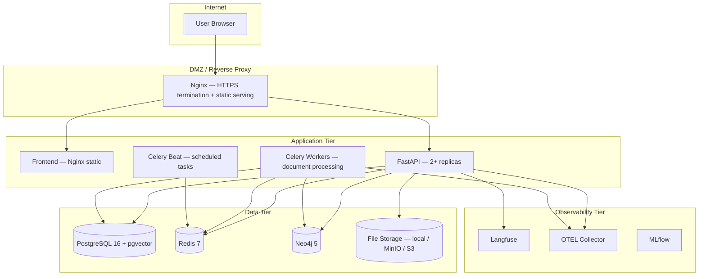
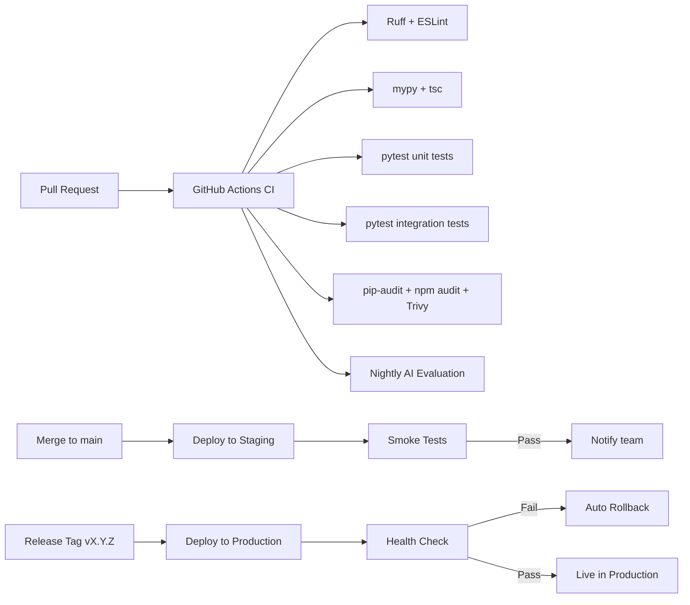

# 11 — Deployment Architecture

## Overview

NEXUS uses Docker Compose for local development and staging, with GitHub Actions
for CI/CD. The architecture is designed to be cloud-agnostic and self-hostable.

---

## Service Topology



---

## Docker Compose Services

```yaml
# docker-compose.yml (abbreviated)

services:
  frontend:
    build: ./frontend
    ports: ["3000:80"]
    depends_on: [backend]

  backend:
    build: ./infra/docker/backend.Dockerfile
    ports: ["8000:8000"]
    env_file: .env
    depends_on: [postgres, redis, neo4j]
    command: uvicorn app.main:app --host 0.0.0.0 --port 8000 --workers 2

  worker:
    build: ./infra/docker/worker.Dockerfile
    env_file: .env
    depends_on: [postgres, redis]
    command: celery -A app.workers worker --loglevel=info --queues=documents,memory,proactive

  beat:
    build: ./infra/docker/worker.Dockerfile
    env_file: .env
    depends_on: [redis]
    command: celery -A app.workers beat --loglevel=info

  postgres:
    image: pgvector/pgvector:pg16
    volumes: [postgres_data:/var/lib/postgresql/data]
    environment:
      POSTGRES_DB: nexus
      POSTGRES_USER: nexus
      POSTGRES_PASSWORD: ${POSTGRES_PASSWORD}
    healthcheck:
      test: ["CMD-SHELL", "pg_isready -U nexus"]
      interval: 10s
      timeout: 5s
      retries: 5

  redis:
    image: redis:7-alpine
    volumes: [redis_data:/data]
    command: redis-server --requirepass ${REDIS_PASSWORD} --appendonly yes

  neo4j:
    image: neo4j:5-community
    volumes: [neo4j_data:/data]
    environment:
      NEO4J_AUTH: neo4j/${NEO4J_PASSWORD}
      NEO4J_PLUGINS: '["apoc"]'
    ports: ["7474:7474", "7687:7687"]

  langfuse:
    image: langfuse/langfuse:latest
    depends_on: [postgres]
    environment:
      DATABASE_URL: ${LANGFUSE_DATABASE_URL}

  mlflow:
    image: ghcr.io/mlflow/mlflow:v2.15.0
    ports: ["5000:5000"]
    volumes: [mlflow_data:/mlruns]
    command: mlflow server --host 0.0.0.0

volumes:
  postgres_data:
  redis_data:
  neo4j_data:
  mlflow_data:
```

---

## Environment Variables

```bash
# .env.example

# Database
POSTGRES_HOST=postgres
POSTGRES_PORT=5432
POSTGRES_DB=nexus
POSTGRES_USER=nexus
POSTGRES_PASSWORD=CHANGE_ME

# Redis
REDIS_HOST=redis
REDIS_PORT=6379
REDIS_PASSWORD=CHANGE_ME

# Neo4j
NEO4J_URI=bolt://neo4j:7687
NEO4J_USER=neo4j
NEO4J_PASSWORD=CHANGE_ME

# AI Providers (configure at least one)
LLM_PROVIDER=openai                     # openai | anthropic | gemini | ollama
OPENAI_API_KEY=                         # Required if LLM_PROVIDER=openai
ANTHROPIC_API_KEY=                      # Required if LLM_PROVIDER=anthropic
GOOGLE_API_KEY=                         # Required if LLM_PROVIDER=gemini
OLLAMA_BASE_URL=http://localhost:11434  # Required if LLM_PROVIDER=ollama

EMBEDDING_PROVIDER=openai               # openai | cohere | local
EMBEDDING_MODEL=text-embedding-3-small

# Application
SECRET_KEY=CHANGE_ME_RANDOM_64_CHARS
ACCESS_TOKEN_EXPIRE_MINUTES=15
REFRESH_TOKEN_EXPIRE_DAYS=30
ALLOWED_ORIGINS=http://localhost:3000

# Observability
LANGFUSE_HOST=http://langfuse:3000
LANGFUSE_PUBLIC_KEY=
LANGFUSE_SECRET_KEY=
OTEL_EXPORTER_OTLP_ENDPOINT=http://otel-collector:4317

# Storage
FILE_STORAGE_BACKEND=local              # local | s3 | minio
FILE_STORAGE_PATH=/app/uploads
```

---

## CI/CD Pipeline



### CI Workflow (`.github/workflows/ci.yml`)

```yaml
name: CI
on: [pull_request]
jobs:
  backend:
    runs-on: ubuntu-latest
    services:
      postgres:
        image: pgvector/pgvector:pg16
        env: {POSTGRES_PASSWORD: test, POSTGRES_DB: nexus_test}
      redis:
        image: redis:7-alpine
    steps:
      - uses: actions/checkout@v4
      - uses: actions/setup-python@v5
        with: {python-version: "3.12"}
      - run: pip install -e ".[dev]"
      - run: ruff check .
      - run: mypy app/
      - run: pytest tests/unit tests/integration --cov=app

  frontend:
    runs-on: ubuntu-latest
    steps:
      - uses: actions/checkout@v4
      - uses: actions/setup-node@v4
        with: {node-version: "20"}
      - run: npm ci
      - run: npm run lint
      - run: npm run type-check
      - run: npm run test

  security:
    runs-on: ubuntu-latest
    steps:
      - uses: actions/checkout@v4
      - run: pip install pip-audit && pip-audit
      - run: npm audit --audit-level=high
      - uses: aquasecurity/trivy-action@master
```

---

## Health Check Endpoints

```
GET /api/health
  → {status: "ok", version: "1.0.0", timestamp: "..."}

GET /api/health/detailed   (internal only)
  → {
      status: "ok",
      services: {
        postgres: "ok",
        redis: "ok",
        neo4j: "ok",
        llm_provider: "ok",
        embedding_provider: "ok"
      },
      version: "1.0.0"
    }
```

---

## Development Environment Setup

```bash
# One-command setup
git clone https://github.com/your-org/nexus-ai
cd nexus-ai
cp .env.example .env        # Fill in your API keys
bash scripts/setup_dev.sh   # Starts all Docker services + runs migrations

# Verify
curl http://localhost:8000/api/health
open http://localhost:3000
open http://localhost:7474   # Neo4j Browser
open http://localhost:5000   # MLflow UI
```

---

## Scaling Considerations (Phase 4+)

| Component | Scaling Strategy |
|-----------|----------------|
| FastAPI | Horizontal scaling — multiple uvicorn replicas behind Nginx |
| Celery Workers | Horizontal — add more workers per queue |
| PostgreSQL | Read replicas for analytics queries |
| Redis | Redis Cluster for high availability |
| Neo4j | Neo4j Causal Cluster (Enterprise) |
| Embeddings | Batch processing with local models to reduce API costs |
| LLM calls | Caching identical prompts in Redis (semantic caching) |
