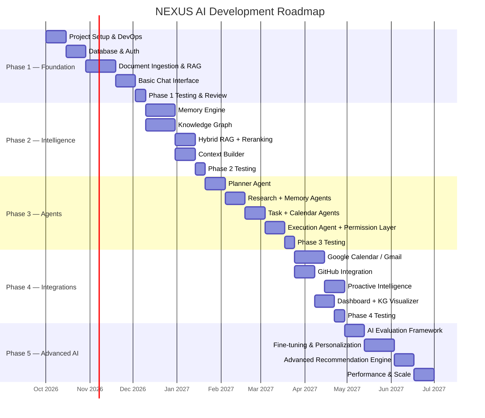

# 12 — Development Phases

## Overview

NEXUS AI is planned across 5 phases, moving from core infrastructure to advanced
agentic capabilities. Each phase delivers a testable, demonstrable increment.

---

## Phase Map

---

## Phase 1: Foundation (~10 weeks)

**Goal**: Functional document-aware chatbot with auth, document ingestion, and basic RAG.

### Milestones

| # | Milestone | Deliverable |
|---|-----------|-------------|
| 1.1 | Project Setup | Monorepo, Docker Compose, CI pipeline |
| 1.2 | Database | All tables, Alembic migrations, pgvector |
| 1.3 | Authentication | Register/login/JWT/refresh |
| 1.4 | Document Ingestion | PDF/DOCX/URL upload, chunking, embedding |
| 1.5 | Basic RAG | Dense vector search, response generation |
| 1.6 | Chat API | Streaming SSE response, conversation management |
| 1.7 | Basic Frontend | Login, chat interface, document upload |
| 1.8 | Observability | Langfuse integration, basic tracing |

**End-of-Phase Demo**: User uploads a resume, then asks "What are my strongest skills?" and receives an accurate, cited answer.

---

## Phase 2: Intelligence (~12 weeks)

**Goal**: Memory, hybrid RAG, knowledge graph, and rich context assembly.

### Milestones

| # | Milestone | Deliverable |
|---|-----------|-------------|
| 2.1 | Episodic Memory | Store and retrieve session summaries |
| 2.2 | Semantic Memory | User facts, contradiction detection |
| 2.3 | Memory Consolidation | Background worker, importance scoring |
| 2.4 | BM25 Retrieval | Hybrid search with pg_trgm |
| 2.5 | Reranking | Cross-encoder reranker integration |
| 2.6 | Citations | Inline citations with source links |
| 2.7 | Entity Extraction | NER with spaCy, Neo4j entity nodes |
| 2.8 | Relationship Extraction | LLM-based, Neo4j edge creation |
| 2.9 | KG Query Engine | NL → Cypher, graph traversal |
| 2.10 | Context Builder | Unified context assembly from all sources |

**End-of-Phase Demo**: NEXUS remembers user's goals from previous sessions and surfaces relevant past context when asked about projects.

---

## Phase 3: Agents (~10 weeks)

**Goal**: Multi-agent system with permission-gated action execution.

### Milestones

| # | Milestone | Deliverable |
|---|-----------|-------------|
| 3.1 | Base Agent Framework | Agent state machine, tool calling, tracing |
| 3.2 | Intent Detector | 6-class intent classification |
| 3.3 | Planner Agent | Task graph generation, sub-agent delegation |
| 3.4 | Research Agent | Multi-source search and synthesis |
| 3.5 | Memory Agent | Memory CRUD with KG sync |
| 3.6 | Task Agent | Task CRUD from natural language |
| 3.7 | Calendar Agent | Slot finding, local event management |
| 3.8 | Execution Agent | Permission layer, audit logging |
| 3.9 | Permission UI | Approval dialog in frontend |
| 3.10 | Agent Observability | Langfuse agent tracing, step visualization |

**End-of-Phase Demo**: The flagship interview preparation example works end-to-end.

---

## Phase 4: Integrations & Frontend (~10 weeks)

**Goal**: External integrations and polished user interface.

### Milestones

| # | Milestone | Deliverable |
|---|-----------|-------------|
| 4.1 | Google Calendar OAuth | Real calendar sync |
| 4.2 | Gmail Integration | Email ingestion and search |
| 4.3 | GitHub Integration | Repo, code, and commit context |
| 4.4 | Proactive Intelligence | Background monitoring, nudges |
| 4.5 | Dashboard | Goals, tasks, calendar, AI insights |
| 4.6 | KG Visualizer | Interactive graph explorer |
| 4.7 | Document Viewer | Annotated viewer with chunk highlighting |
| 4.8 | Settings UI | Integration management, permissions |

---

## Phase 5: Advanced AI & Scale (~8 weeks)

**Goal**: Systematic AI quality improvement and production readiness.

### Milestones

| # | Milestone | Deliverable |
|---|-----------|-------------|
| 5.1 | Evaluation Framework | Automated LLM-as-judge evaluations |
| 5.2 | Evaluation Datasets | Curated RAG QA, intent, planning benchmarks |
| 5.3 | MLflow Integration | Experiment tracking for all evals |
| 5.4 | Personalization | Per-user prompt tuning from feedback |
| 5.5 | Recommendation Engine | Cross-domain proactive recommendations |
| 5.6 | Semantic Caching | Redis-based LLM response caching |
| 5.7 | Load Testing | k6 load tests, performance baselines |
| 5.8 | Security Audit | Penetration testing, dependency audit |

---

## Definition of Done (Per Feature)

A feature is "done" when it has:
- [ ] Implementation code
- [ ] Unit tests (>80% coverage of new code)
- [ ] Integration test
- [ ] API documentation (OpenAPI)
- [ ] Langfuse tracing
- [ ] Error handling
- [ ] Logging (structured JSON logs)
- [ ] Code review approved
