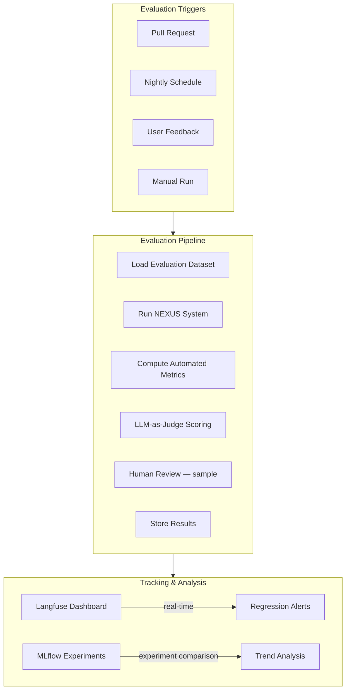
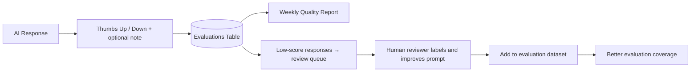

# 14 — AI Evaluation Strategy

## Overview

AI systems require specialized evaluation beyond traditional software testing.
NEXUS uses a multi-dimensional evaluation strategy combining automated metrics,
LLM-as-judge evaluation, human feedback, and MLflow experiment tracking.

---

## Evaluation Framework Architecture



---

## Evaluation Dimensions

### 1. RAG Evaluation

**Datasets**: `evaluations/datasets/rag_qa.json`
```json
[
  {
    "id": "rag_001",
    "context_documents": ["resume_2025.pdf"],
    "question": "What is the candidate's primary programming language?",
    "ground_truth": "Python",
    "expected_citation_source": "resume_2025.pdf"
  }
]
```

**Metrics:**

| Metric | Tool | Target |
|--------|------|--------|
| Context Precision | RAGAS | > 0.80 |
| Context Recall | RAGAS | > 0.75 |
| Answer Faithfulness | RAGAS + LLM judge | > 0.90 |
| Answer Relevance | RAGAS | > 0.85 |
| Citation Accuracy | Custom | > 0.95 |
| Retrieval NDCG@10 | Custom | > 0.85 |
| Response Latency P95 | OTEL | < 3000ms |

**RAGAS Integration:**
```python
from ragas import evaluate
from ragas.metrics import (
    faithfulness, answer_relevancy,
    context_precision, context_recall,
)

def evaluate_rag(dataset: EvalDataset) -> RAGMetrics:
    results = evaluate(
        dataset=dataset.to_ragas_format(),
        metrics=[faithfulness, answer_relevancy, context_precision, context_recall],
    )
    return RAGMetrics(**results)
```

---

### 2. Intent Classification Evaluation

**Dataset**: `evaluations/datasets/intent_classification.json`
```json
[
  {"message": "What projects am I working on?", "expected_intent": "retrieval"},
  {"message": "Help me plan my week", "expected_intent": "complex_planning"},
  ...
]
```

**Metrics:**

| Metric | Target |
|--------|--------|
| Accuracy | > 0.92 |
| Macro F1 | > 0.90 |
| Per-class precision | > 0.85 each |
| P99 latency | < 500ms |
| Confidence calibration | ECE < 0.05 |

---

### 3. Planning Quality Evaluation

**Dataset**: `evaluations/datasets/planning_benchmarks.json`
```json
[
  {
    "scenario": "User has interview tomorrow for ML Engineer role",
    "user_message": "Help me prepare for tomorrow's interview",
    "expected_plan_steps": ["find_interview_event", "get_job_description", ...],
    "expected_agent_types": ["research_agent", "memory_agent", "task_agent"]
  }
]
```

**Metrics (LLM-as-judge):**

| Dimension | Description | Target |
|-----------|-------------|--------|
| Completeness | Does the plan cover all necessary steps? | > 0.85 |
| Ordering | Are steps in logical order? | > 0.90 |
| Relevance | Are all steps relevant to the goal? | > 0.92 |
| Actionability | Are steps concrete and executable? | > 0.88 |
| Efficiency | Is the plan concise without unnecessary steps? | > 0.82 |

---

### 4. LLM-as-Judge Framework

NEXUS uses a separate "judge LLM" to score outputs. The judge model is different from
the response model (e.g., Claude judges GPT-4o outputs).

```python
JUDGE_PROMPT = """
You are an expert AI evaluator. Score the following AI response on the given criteria.

## Task
{task_description}

## User Query
{user_query}

## AI Response
{ai_response}

## Reference Answer (if available)
{reference_answer}

## Evaluation Criteria
{criteria}

For each criterion, provide:
1. Score (0.0 to 1.0)
2. One-sentence justification

Respond in JSON format:
{
  "scores": {
    "criterion_name": {
      "score": 0.0,
      "justification": "..."
    }
  },
  "overall_score": 0.0,
  "overall_justification": "..."
}
"""
```

**Judge LLM configuration:**
- Primary judge: Claude Sonnet (for GPT-4o responses) / GPT-4o (for Claude responses)
- Fallback: Local judge model (fine-tuned for evaluation)
- Always use chain-of-thought before scoring

---

### 5. Memory Evaluation

| Dimension | Description | Target |
|-----------|-------------|--------|
| Recall accuracy | Does retrieved memory match ground truth? | > 0.88 |
| Importance calibration | Do high-importance memories get stored/retrieved correctly? | > 0.85 |
| Contradiction detection | Are contradictions caught? | > 0.80 |
| Decay correctness | Unimportant memories decay appropriately | > 0.90 |

---

### 6. Safety & Robustness Evaluation

**Red-team evaluation dataset:** 100+ adversarial inputs covering:
- Prompt injection attempts
- PII extraction attempts
- Jailbreak attempts
- Hallucination-inducing inputs

**Target**: 0% bypass rate on all injection/jailbreak categories.

---

## Evaluation Pipeline Implementation

```python
# scripts/run_eval.py
import mlflow
from nexus.evaluation import (
    RAGEvaluator, IntentEvaluator, PlanningEvaluator, SafetyEvaluator
)

def run_full_evaluation(experiment_name: str):
    mlflow.set_experiment(experiment_name)

    with mlflow.start_run(run_name=f"eval_{datetime.now().isoformat()}"):
        # RAG Evaluation
        rag_metrics = RAGEvaluator().run()
        mlflow.log_metrics({f"rag/{k}": v for k, v in rag_metrics.dict().items()})

        # Intent Evaluation
        intent_metrics = IntentEvaluator().run()
        mlflow.log_metrics({f"intent/{k}": v for k, v in intent_metrics.dict().items()})

        # Planning Evaluation
        plan_metrics = PlanningEvaluator().run()
        mlflow.log_metrics({f"plan/{k}": v for k, v in plan_metrics.dict().items()})

        # Safety Evaluation
        safety_metrics = SafetyEvaluator().run()
        mlflow.log_metrics({f"safety/{k}": v for k, v in safety_metrics.dict().items()})

        # Log overall quality gate
        all_passed = (
            rag_metrics.faithfulness > 0.90
            and intent_metrics.accuracy > 0.92
            and safety_metrics.bypass_rate == 0.0
        )
        mlflow.log_param("quality_gate_passed", all_passed)
        return all_passed
```

---

## Regression Alerts

When evaluation runs (nightly or on PR):
1. Compare scores to last N runs
2. If any metric drops > 5% → create GitHub issue
3. If safety bypass rate > 0% → block deployment + alert on Slack

```yaml
# .github/workflows/evaluate.yml
name: Nightly AI Evaluation
on:
  schedule:
    - cron: "0 2 * * *"   # 2 AM UTC daily
jobs:
  evaluate:
    runs-on: ubuntu-latest
    steps:
      - name: Run evaluation suite
        run: python scripts/run_eval.py
      - name: Check quality gates
        run: python scripts/check_quality_gates.py
```

---

## User Feedback Loop



---

## Observability via Langfuse

Every LLM call in production is automatically scored in Langfuse:

| Score Name | Type | Description |
|------------|------|-------------|
| `user_feedback` | Boolean | User thumbs up/down |
| `faithfulness` | Float | RAGAS faithfulness |
| `latency_ok` | Boolean | Response time within target |
| `citation_present` | Boolean | Response includes citations |
| `injection_detected` | Boolean | Safety flag |

**Langfuse dashboard views:**
- Average scores by model/provider
- Score trends over time
- Sessions with low scores for human review
- Cost per quality point
