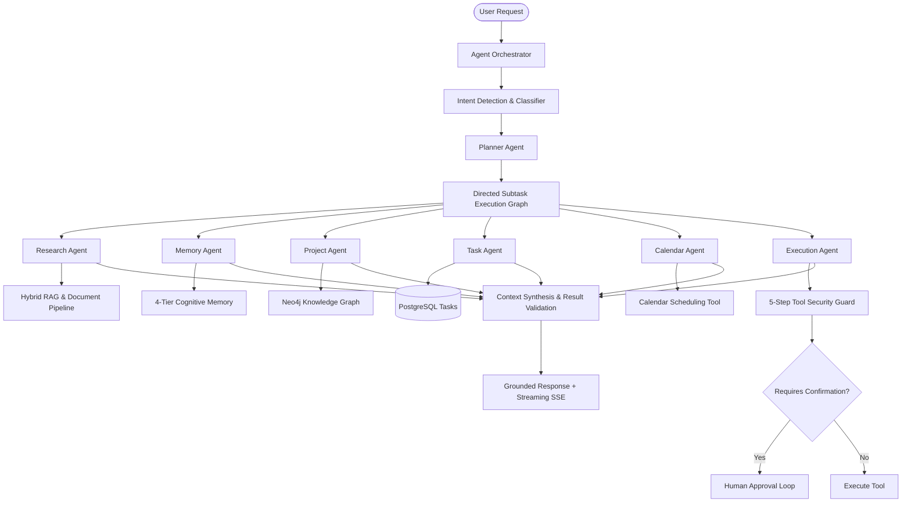

# Multi-Agent Architecture

> **NEXUS AI — Hierarchical Multi-Agent Orchestration System**

NEXUS AI utilizes a hierarchical multi-agent architecture where a master **Planner Agent** decomposes high-level user requests into directed execution graphs executed by specialized sub-agents. A central **Agent Orchestrator** manages execution state, enforces fault tolerance, coordinates multi-source context, and streams safe activity updates to the frontend.

---

## 1. Multi-Agent Hierarchy



---

## 2. Agent Roles & Responsibilities

| Agent | Core Responsibility | Inputs | Outputs | Primary Tools |
|---|---|---|---|---|
| **Planner Agent** | Decomposes complex user goals into ordered, prioritized subtasks. | User prompt, conversation history | Structured `PlannerOutput` (subtask list, dependencies) | Internal planning heuristics |
| **Research Agent** | Multi-source investigation across uploaded documents, notes, and chunks. | Query terms, document filters | Synthesized evidence, cited snippets | `document_tool`, `search_tool` |
| **Memory Agent** | Selective memory recall using calibrated semantic & importance thresholds. | User query, active intent | Relevant semantic facts and episodic memories | `memory_tool` |
| **Project Agent** | Evaluates user projects and builds competency matrices against requirements. | Job description, user projects | Skill gap matrix (strong, weak, missing skills) | `project_tool`, `graph_tool` |
| **Task Agent** | Converts plans and recommendations into actionable database tasks. | Study blocks, action items | Persisted `Task` records with due dates | `task_tool` |
| **Calendar Agent** | Detects free time blocks, prevents conflicts, and structures schedules. | Time intervals, task durations | Proposed calendar event intervals | `calendar_tool` |
| **Execution Agent** | Interfaces with tools and stages action proposals for human approval. | Tool invocations, parameters | Staged `ActionProposal` or execution result | 5-Step `SecurityGuard` |

---

## 3. Orchestration & State Tracking

The central orchestrator (`app.services.agents.orchestrator.AgentOrchestrator`) tracks each execution run:

```python
class AgentState(BaseModel):
    agent_type: AgentType
    status: AgentStatus  # pending, running, completed, failed, skipped
    input_data: Dict[str, Any]
    output_data: Optional[Dict[str, Any]] = None
    error: Optional[str] = None
    start_time: Optional[datetime] = None
    end_time: Optional[datetime] = None
    duration_ms: Optional[int] = None
    retries: int = 0
```

### Orchestration Lifecycle:
1. **Run Initialization**: Assigns a unique UUID `run_id` and records the request.
2. **Intent & Planning**: Calls the Planner Agent to build the subtask sequence.
3. **Agent Delegation**: Iterates through subtasks, delegating to the appropriate specialized agent.
4. **Context Passing**: Intermediate outputs (e.g., extracted skills from Research Agent) are fed as inputs to downstream agents (e.g., Project Agent gap analysis).
5. **State Logging**: Every stage transition updates `AgentState` with timing, status, and outputs.
6. **Result Validation**: Validates that all critical subtasks completed; triggers fallbacks for any degraded steps.

---

## 4. Fault Tolerance & Graceful Fallbacks

NEXUS AI agents operate under a zero-crash resilience policy:
- **Exponential Backoff**: Transient tool failures are retried up to 2 times with exponential delay ($1.0\text{s}$, $2.0\text{s}$).
- **Graceful Fallback Handlers**:
  - *If a Job Description is missing*: Falls back to standard domain competencies derived from candidate projects.
  - *If Calendar access fails*: Emits recommended time intervals in text without blocking task creation.
  - *If Neo4j is offline*: Transparently queries the in-memory graph fallback.
  - *If LLM API is unavailable*: Synthesizes responses using built-in deterministic planning templates.

---

## 5. Safe Activity Streaming (Zero Chain-of-Thought Leaks)

To provide clear UX while protecting security and user privacy, the multi-agent system streams **high-level activity status labels** via Server-Sent Events (SSE):

```text
event: activity
data: {"label": "Understanding request...", "agent": "planner", "status": "running"}

event: activity
data: {"label": "Reading job description...", "agent": "research", "status": "running"}

event: activity
data: {"label": "Analyzing your skills...", "agent": "project", "status": "running"}

event: activity
data: {"label": "Waiting for calendar approval...", "agent": "calendar", "status": "waiting"}
```

- **Zero CoT Exposure**: Internal reasoning traces, system prompts, raw database connection strings, and credential IDs are strictly withheld from the stream.
- **Frontend Feedback**: The web app animates the active agent avatar and displays a collapsible activity progress stepper.

---

## 6. Multi-Agent API Inspection

Developers and administrators can inspect multi-agent executions via REST:

| Method | Endpoint | Description |
|---|---|---|
| `POST` | `/api/v1/agents/orchestrate` | Submit a general multi-agent orchestration request |
| `GET` | `/api/v1/agents/runs/{run_id}` | Inspect detailed agent states, execution timings, and subtask results |
| `GET` | `/api/v1/agents/definitions` | List all registered agents, capabilities, and required permissions |
