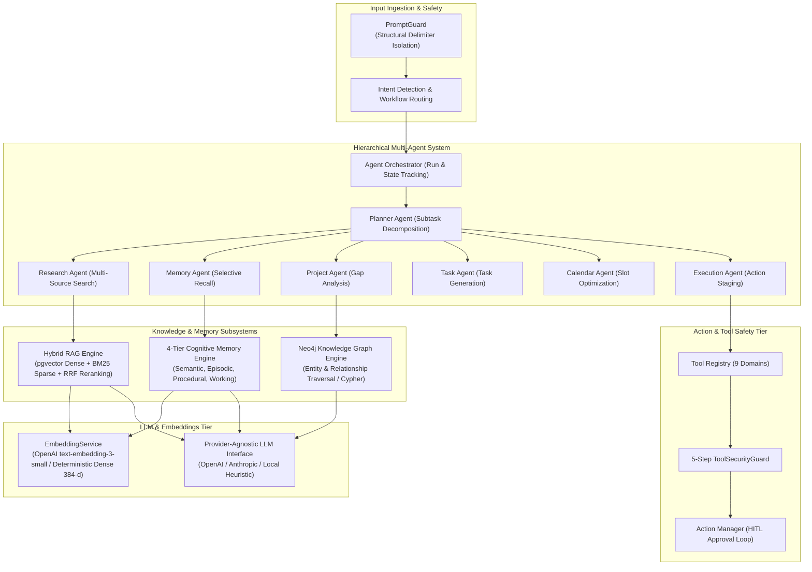
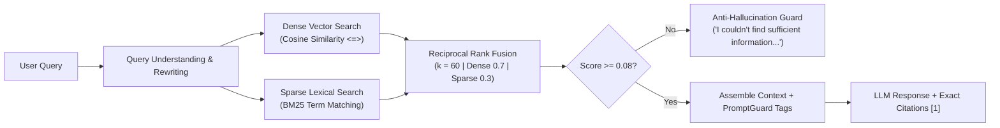
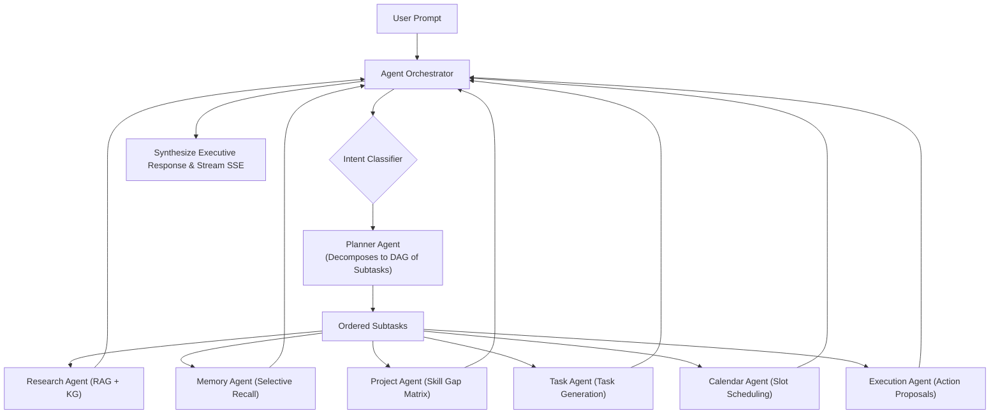

# AI Architecture

> **NEXUS AI — Cognitive Intelligence & Multi-Agent Architecture**

This document details the artificial intelligence architecture of NEXUS AI, covering model abstractions, vector embeddings, hybrid RAG, cognitive memory, knowledge graph reasoning, hierarchical multi-agent orchestration, and controlled tool safety.

---

## 1. High-Level AI Component Architecture

---

## 2. LLM Provider Abstraction & Offline Resilience

NEXUS AI is built to operate seamlessly across both cloud LLM providers and fully offline environments:

- **Provider Agnosticism**: Compatible with OpenAI (`gpt-4o`, `gpt-4o-mini`), Anthropic (`claude-3-5-sonnet`), and local inference endpoints via standard HTTP APIs.
- **Zero-Cost Offline Fallback**: If no remote API key is supplied, NEXUS AI does not crash or fail. Instead, it activates its built-in rule-based heuristic generation engine to assemble structured answers, synthesize interview prep blocks, formulate study topics, and generate tasks.
- **Streaming Token Protocol**: Generates real-time Server-Sent Events (SSE) through FastAPI `StreamingResponse` for smooth token-by-token UI rendering.

---

## 3. Embedding Subsystem (`EmbeddingService`)

The vector embedding engine generates 384-dimensional dense vectors used for document chunks and cognitive memories:

1. **Remote Cloud Embeddings**:
   - Model: OpenAI `text-embedding-3-small`.
   - Dimension: Automatically mapped to 384 dimensions.
   - Used when `OPENAI_API_KEY` is provided in `.env`.
2. **Built-in Local Dense Vectorizer**:
   - Fully offline, zero-dependency subword-frequency vectorizer with L2 normalization.
   - Incorporates domain semantic associations (e.g., expanding `"cloud"` to include `"aws"`, `"azure"`, `"gcp"`; expanding `"container"` to include `"docker"`, `"kubernetes"`).
   - Guarantees deterministic, reproducible vector embeddings for local testing and zero-cost operation.

---

## 4. Hybrid Retrieval-Augmented Generation (RAG)

NEXUS AI solves the semantic-lexical retrieval trade-off by operating a dual-channel hybrid pipeline:

- **Query Rewriting**: Strips conversational preambles (e.g., *"Could you please tell me..."*) and isolates core search keywords.
- **Reciprocal Rank Fusion (RRF)**:
  $$\text{RRF\_Score}(d) = \sum_{m \in \{\text{dense}, \text{sparse}\}} \frac{w_m}{k + \text{rank}_m(d)}$$
  Where $k = 60$, $w_{\text{dense}} = 0.7$, and $w_{\text{sparse}} = 0.3$.
- **Anti-Hallucination Guard**: If the top retrieval score fails the relevance threshold ($0.08$) or if no documents exist, the system immediately returns:
  > *"I couldn't find sufficient information in your connected knowledge."*

---

## 5. 4-Tier Cognitive Memory Subsystem

NEXUS AI mirrors human cognitive architecture through four complementary memory tiers:

| Tier | Type | Characteristics | Example |
|---|---|---|---|
| 1 | **Semantic** | Factual user knowledge, skills, credentials | *"User has 5 years of Python and Kubernetes experience."* |
| 2 | **Episodic** | Time-indexed experiences and milestones | *"User prepared for Google Cloud Architect interview in 2026."* |
| 3 | **Procedural**| User preferences, communication styles | *"User prefers concise answers and dark mode."* |
| 4 | **Working** | Current active task and session focus | *"User is currently debugging memory deduplication."* |

### Memory Processing Lifecycle
1. **Noise Filtering**: Automatically drops pure greetings, pleasantries, and generic questions.
2. **Canonical Transformation**: Converts 1st-person statements (*"I know Python"*) into 3rd-person declarative facts (*"User knows Python"*).
3. **Importance Scoring**: Calibrated importance score from $0.0$ to $1.0$ (threshold $\ge 0.40$ for storage).
4. **Deduplication Engine**: Cosine similarity check ($0.82$ threshold) merges or reinforces existing records without creating redundant database rows.
5. **Multi-Signal Retrieval**:
   $$\text{Score} = 0.45 \times \text{CosineSim} + 0.35 \times \text{LexicalOverlap} + 0.20 \times \text{Importance}$$

---

## 6. Knowledge Graph (Neo4j & In-Memory Store)

The Knowledge Graph represents multi-hop relationships connecting user assets:
- **Ontology**: 11 typed entities (`User`, `Project`, `Skill`, `Technology`, `Document`, `Task`, `Goal`, `Event`, `Company`, `Job`, `Topic`) and 10 directed relationships (`OWNS`, `USES`, `KNOWS`, `REQUIRES`, `DESCRIBES`, `SUPPORTS`, `RELATES_TO`, `HAS_TASK`, `HAS_GOAL`, `WORKS_AT`).
- **Automated Ingestion**: Ingested documents extract entities automatically; relational DB models sync directly into graph nodes upon creation.
- **Graph-Augmented RAG**: Traverses 1-hop and 2-hop neighborhoods around retrieved entities to inject structured relational context into the LLM prompt.
- **In-Memory Store Fallback**: If Neo4j Community container is offline, `InMemoryGraphStore` provides seamless node/edge operations and Cypher matching.

---

## 7. Hierarchical Multi-Agent System

- **Planner Agent**: Analyzes intent and constructs an ordered execution graph.
- **Research Agent**: Fetches vector chunks, documents, and external knowledge.
- **Memory Agent**: Performs selective recall using strict relevance thresholds (avoids prompt bloat).
- **Project Agent**: Maps user repositories and past work against job requirements to build a structured competency matrix.
- **Task Agent**: Transforms strategic recommendations into actionable database tasks.
- **Calendar Agent**: Discovers conflict-free time slots for preparation blocks.
- **Execution Agent**: Interfaces with the secure tool execution pipeline.
- **Fault Tolerance**: Up to 2 retries with exponential backoff and graceful degraded fallbacks.
- **Activity Streaming**: Emits clean user-friendly activity labels (`Planning...`, `Analyzing skills...`) over SSE with zero chain-of-thought exposure.

---

## 8. Tools & Security Guard

- **9 Registered Tool Domains**: `task`, `calendar`, `documents`, `memory`, `projects`, `knowledge_graph`, `search`, `email`, `github`.
- **5-Step Tool Security Guard**:
  1. *User Permission Validation*: Ensures active user account and role prerequisites.
  2. *Tool Permission Validation*: Verifies tool registration and permitted action scopes.
  3. *Input Schema Sanitization*: Scans for path traversal (`../`), null bytes (`\x00`), and shell chaining.
  4. *Risk Assessment*: Classifies into `read_only`, `low`, `medium`, `high`, `critical`.
  5. *Confirmation Requirement*: Mandates explicit human confirmation for any `high` or `critical` action via pending `ActionProposal`.
- **Credential-Sanitized Audit Trail**: Automatically redacts passwords, tokens, API keys, and authorization headers before persisting to `audit_logs`.
