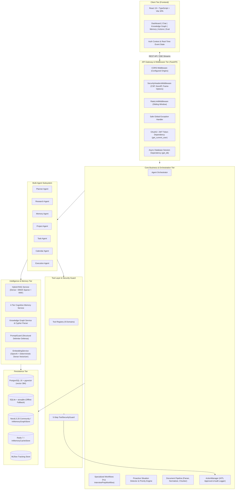
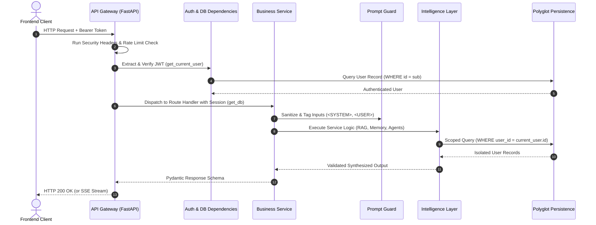

# System Architecture

> **NEXUS AI — Agentic Personal Intelligence & Productivity Platform**

This document provides a comprehensive technical overview of the system architecture of NEXUS AI, detailing the frontend, backend, persistence layer, intelligence engines, multi-agent orchestrator, and security guardrails.

---

## 1. High-Level Architectural Topology

NEXUS AI is built as a modular, asynchronous full-stack platform. The architecture separates client interaction, API routing, cognitive intelligence processing, multi-agent orchestration, and polyglot persistence.



---

## 2. Layer Breakdown

### 2.1 Frontend Client Tier
- **Framework**: React 19 with TypeScript and Vite.
- **Design System**: Modern custom AI SaaS stylesheet (`frontend/src/index.css`) featuring glassmorphism, tailored dark mode palettes, responsive layouts, and interactive canvas components.
- **Iconography**: `lucide-react`.
- **State Management**: React Context (`AuthContext`) handling token persistence, authenticated user state, and SSE streaming lifecycle.
- **Core Views**:
  - `Dashboard`: Productivity metrics, completion rates, upcoming deadlines, and proactive AI recommendations.
  - `Chat`: Real-time token streaming via Server-Sent Events, interactive Knowledge Vault uploader, tool status badges, and clickable citations.
  - `KnowledgeGraph`: HTML5 Canvas force-directed graph visualization with search, category filtering, and node metadata drawer.
  - `Memory`: 4-tier memory cards with live search, importance filters, and CRUD dialogs.
  - `Actions`: Human-in-the-loop action approval cards and immutable, credential-sanitized audit log inspector.
  - `Evaluation`: AI evaluation dashboard displaying RAG metrics, Agent operational benchmarks, waterfall distributed traces, and MLflow registry status.
  - `Tasks`, `Projects`, `Goals`: Structured productivity tracking views.

### 2.2 API Gateway & Security Middleware
- **Framework**: FastAPI (ASGI runtime running on Uvicorn).
- **Authentication**: Bearer tokens signed with HS256 JWT, verified by `app.api.deps.get_current_user`.
- **Middleware Pipeline**:
  1. `SecurityHeadersMiddleware`: Injects defensive HTTP response headers (`X-Content-Type-Options: nosniff`, `X-Frame-Options: DENY`, `X-XSS-Protection: 1; mode=block`, `Referrer-Policy: strict-origin-when-cross-origin`, and `Content-Security-Policy`).
  2. `RateLimitMiddleware`: In-memory sliding window rate limiter enforcing 15 req/min on authentication routes and 300 req/min on general routes.
  3. `CORSMiddleware`: Strict origin whitelisting (`http://localhost:3000`, `http://localhost:5173`, etc.).
  4. `safe_exception_handler`: Traps unhandled exceptions and returns sanitized JSON error objects with unique incident UUIDs, preventing internal stack traces and database schema leakage.

### 2.3 Polyglot Storage Tier
1. **Relational & Vector Store (PostgreSQL 16 + pgvector)**:
   - Tables: `users`, `profiles`, `projects`, `tasks`, `goals`, `documents`, `document_chunks`, `memories`, `calendar_events`, `action_proposals`, `audit_logs`, `recommendations`.
   - Vector columns: `document_chunks.embedding` (`vector(384)`) and `memories.embedding` (`vector(384)`).
   - Cosine operator: `<=>`.
   - Zero-dependency local testing fallback to SQLite (`sqlite+aiosqlite`) with JSON-serialized vector distance calculations.
2. **Graph Database (Neo4j 5.20 Community + APOC)**:
   - Graph modeling across 11 entity types and 10 typed directed relationships.
   - Transparent in-memory fallback (`InMemoryGraphStore`) providing isolated node/edge storage and Cypher parsing when Neo4j is offline.
3. **Cache & Ephemeral Store (Redis 7)**:
   - Asynchronous cache client (`app.core.redis_client.RedisClient`) with automatic in-memory key-value store fallback (`InMemoryCacheStore`) with TTL support.

---

## 3. Request Lifecycle

The standard request lifecycle through NEXUS AI follows strict multi-tenant boundaries:



---

## 4. Multi-Tenant User Isolation Guarantee

NEXUS AI enforces **Hermetic Multi-Tenancy** across all storage engines:

1. **Relational Database**:
   - Every primary entity table contains a non-nullable foreign key `user_id` referencing `users.id`.
   - All SQLAlchemy queries explicitly bind `Model.user_id == current_user.id`.
   - Nested resources (such as tasks under projects) perform joint ownership checks:
     ```python
     stmt = select(Project).where(Project.id == task_in.project_id, Project.user_id == current_user.id)
     ```
2. **Vector Retrieval**:
   - Vector similarity matches are filtered at query time:
     ```sql
     SELECT * FROM document_chunks WHERE user_id = :user_id ORDER BY embedding <=> :query_vector LIMIT :top_k;
     ```
   - Cross-tenant vector leakage is architecturally impossible.
3. **Neo4j Knowledge Graph**:
   - All nodes and relationships carry a `user_id` property.
   - Cypher queries parameterize tenant identity:
     ```cypher
     MATCH (n {user_id: $user_id}) RETURN n;
     ```
4. **Action Proposals & Audit Logs**:
   - Action proposals and execution audits are stamped with `user_id` and can only be queried or approved by that specific authenticated user.
