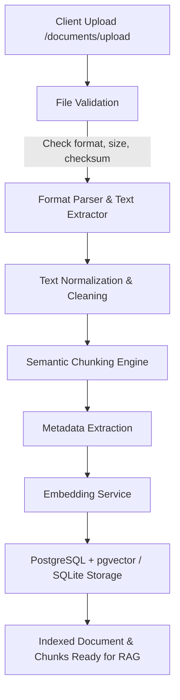

# Document Ingestion Pipeline

> **NEXUS AI - Phase 2 Document Intelligence**

The Document Ingestion Pipeline powers NEXUS AI's document intelligence layer. It accepts raw unstructured files uploaded by users, validates and parses them, cleans the extracted text, decomposes it into semantically coherent overlapping chunks, generates high-dimensional vector embeddings, and indexes them in PostgreSQL with `pgvector` while enforcing strict multi-tenant user isolation.

---

## 1. Pipeline Overview



---

## 2. Supported Formats & Extraction Strategies

The pipeline supports five primary document formats with dedicated parsers in [`backend/app/services/document_pipeline.py`](file:///c:/Users/91894/OneDrive/Desktop/Nexus%20AI/backend/app/services/document_pipeline.py):

| Format | Extension | Extractor / Engine | Strategy |
|---|---|---|---|
| **Portable Document Format** | `.pdf` | `pypdf.PdfReader` | Iterates pages, extracts text, strips headers/footers, captures page count and structure |
| **Microsoft Word** | `.docx` | `docx.Document` (`python-docx`) | Iterates paragraphs and table cells, concatenates structural blocks |
| **Plain Text** | `.txt` | Native Python UTF-8 reader | Decodes with UTF-8 / latin-1 fallback, normalizes line breaks |
| **Markdown** | `.md` | Native structural parser | Retains header tags (`#`, `##`) for chunk-boundary awareness |
| **Comma-Separated Values** | `.csv` | Python `csv.reader` / `csv.DictReader` | Formats rows into structured `"Row N: col1=val1, col2=val2"` representations |

---

## 3. Step-by-Step Processing Stages

### Stage 1: Validation
- **Size Ceiling**: Enforces maximum upload size of **15MB** per document.
- **Allowed Extensions**: `.pdf`, `.docx`, `.txt`, `.md`, `.csv`.
- **Integrity**: Computes SHA-256 hash of file content to detect duplicates and ensure file integrity.
- **Empty File Guard**: Rejects 0-byte or whitespace-only files with HTTP 400.

### Stage 2: Parsing & Text Extraction
- Extracts raw text using the appropriate parser.
- Handles multi-page documents, nested tables, and disparate encodings gracefully.
- Raises descriptive HTTP 400 errors if files are corrupt, password-protected, or unreadable.

### Stage 3: Cleaning & Normalization
- Normalizes unicode whitespace (non-breaking spaces, zero-width characters).
- Collapses redundant consecutive blank lines into double newlines for paragraph preservation.
- Strips non-printable ASCII control characters while keeping standard indentation and newlines.
- Normalizes carriage returns (`\r\n` -> `\n`).

### Stage 4: Semantic Chunking Engine
Chunks are formed using a sliding window algorithm calibrated for retrieval precision:
- **Target Chunk Size**: ~500 tokens (approx. 2000 characters).
- **Chunk Overlap**: ~100 tokens (approx. 400 characters) to avoid boundary fragmentation.
- **Boundary Preservation**: Splits preferentially along paragraphs (`\n\n`), sentence boundaries (`. `, `? `, `! `), and newline breaks rather than arbitrary character cuts.
- **Chunk Metadata**: Each chunk stores its sequential `chunk_index`, character counts, and parent `document_id`.

### Stage 5: Metadata Extraction
The pipeline extracts and persists document-level and chunk-level metadata:
- **Document Level**:
  - `filename`: Original upload filename.
  - `document_type`: Inferred type (`pdf`, `docx`, `txt`, `markdown`, `csv`).
  - `file_size_bytes`: Exact byte size.
  - `sha256`: Content checksum.
  - `total_chunks`: Total number of indexed chunks.
  - `char_count` & `word_count`: Corpus size statistics.
  - `created_at` & `updated_at`: UTC timestamps.
- **Chunk Level**:
  - `chunk_index`: 0-indexed position.
  - `char_count`: Length of chunk.
  - `start_char` / `end_char`: Offset spans.

### Stage 6: Embedding Generation
- Embeddings are generated via [`EmbeddingService`](file:///c:/Users/91894/OneDrive/Desktop/Nexus%20AI/backend/app/services/embedding.py).
- Supported backends:
  - **OpenAI**: `text-embedding-3-small` (1536 dims, cosine normalized).
  - **Local Deterministic Dense Vectorizer**: 384-dimensional dense semantic vectors with n-gram character and token hashing, L2 normalized, used for deterministic offline tests and local development without requiring external API keys.
- Cosine similarity metric:
  $$\text{sim}(u, v) = \frac{u \cdot v}{\|u\| \|v\|}$$

### Stage 7: Database Persistence & User Isolation
- Persisted to PostgreSQL using SQLAlchemy 2.0 async session.
- **Schema**:
  - `documents`: Stores document metadata with foreign key `user_id -> users.id (ON DELETE CASCADE)`.
  - `document_chunks`: Stores chunks and embeddings with foreign key `document_id -> documents.id` and `user_id -> users.id`.
- **Indexing**: `vector(384)` with `ivfflat` / `hnsw` cosine operator `<=>` on PostgreSQL + `pgvector`.
- SQLite fallback uses JSON serialization for vector persistence in test environments.

---

## 4. API Endpoints

### 1. Upload Document
```http
POST /api/v1/documents/upload
Content-Type: multipart/form-data
Authorization: Bearer <jwt_token>

file: <binary_file>
```

**Response (HTTP 201 Created)**:
```json
{
  "id": "e3b0c442-98fc-1c14-9afb-4c7fa4f00999",
  "filename": "resume.pdf",
  "document_type": "pdf",
  "file_size_bytes": 1048576,
  "chunk_count": 4,
  "metadata": {
    "total_chars": 6420,
    "total_words": 980,
    "sha256": "8f434346648f6b96df89dda901c5176b10a6d83961dd3c1ac88b59b2dc327aa4"
  },
  "created_at": "2026-10-14T01:00:00Z"
}
```

### 2. List Documents
```http
GET /api/v1/documents
Authorization: Bearer <jwt_token>
```

### 3. Get Document Details
```http
GET /api/v1/documents/{id}
Authorization: Bearer <jwt_token>
```

### 4. Delete Document
```http
DELETE /api/v1/documents/{id}
Authorization: Bearer <jwt_token>
```
*Note: Deleting a document automatically cascades and removes all associated chunks and vector embeddings.*
