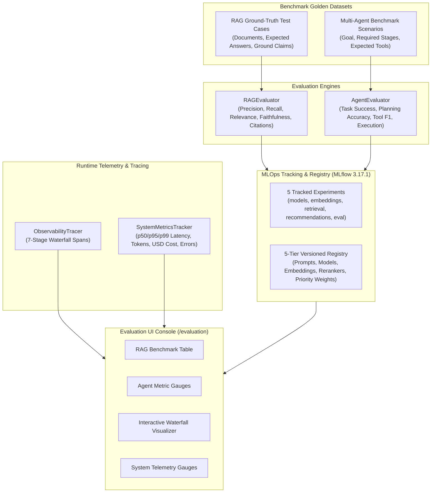

# AI Evaluation, Observability & MLOps

> **NEXUS AI — Quantitative AI Benchmarking, Distributed Tracing & MLOps**

NEXUS AI incorporates a production-grade AI evaluation suite, distributed execution tracing across 7 pipeline stages, real-time telemetry, and MLOps tracking powered by **MLflow 3.17.1**.

---

## 1. Quantitative AI Evaluation Architecture

---

## 2. RAG Evaluation Engine (`RAGEvaluator`)

The RAG evaluation suite (`app.evaluation.rag_evaluator.RAGEvaluator`) benchmarks retrieval quality and generation grounding against golden evaluation datasets:

| Metric | Target | Formula / Logic | Description |
|---|---|---|---|
| **Context Precision** | $\ge 90\%$ | $\frac{\text{Relevant Retrieved Chunks}}{\text{Total Retrieved Chunks}}$ | Evaluates noise ratio in retrieved context; penalizes irrelevant vector chunks. |
| **Context Recall** | $\ge 90\%$ | $\frac{\text{Ground Truth Facts Retrieved}}{\text{Total Ground Truth Facts}}$ | Measures whether the retrieval pipeline captured all key facts from source documents. |
| **Answer Relevance** | $\ge 95\%$ | Semantic alignment & fact coverage | Evaluates whether the generated response directly answers the query or properly triggers anti-hallucination. |
| **Faithfulness** | $\ge 95\%$ | $\frac{\text{Grounded Claims}}{\text{Total Claims in Answer}}$ | Zero-hallucination check ensuring every claim in the response is supported by context. |
| **Citation Accuracy** | $\ge 95\%$ | $\frac{\text{Valid Citations}}{\text{Total Citations}}$ | Verifies that numerical citations `[N]` reference genuine source documents with verbatim excerpt overlap. |

### Anti-Hallucination Guardrail Verification
Adversarial test cases (e.g., out-of-domain queries, missing documents) explicitly verify that the system returns:
> *"I couldn't find sufficient information in your connected knowledge."*

---

## 3. Multi-Agent Evaluation Engine (`AgentEvaluator`)

The multi-agent evaluation suite (`app.evaluation.agent_evaluator.AgentEvaluator`) tests autonomous multi-step workflows against benchmark scenarios:

| Metric | Target | Description |
|---|---|---|
| **Task Success Rate** | $\ge 95\%$ | Proportion of complex multi-agent workflows that successfully fulfill user goals without errors. |
| **Planning Accuracy** | $\ge 90\%$ | Measures whether the Planner Agent's subtask sequence contains all mandatory operational stages in valid topological order. |
| **Tool Selection Accuracy**| $\ge 95\%$ | Harmonic mean (F1 score) of invoked tools vs. required tools (calendar, task, memory, documents). |
| **Execution Success** | $\ge 98\%$ | Percentage of proposed tool calls and actions that execute cleanly upon confirmation. |
| **Failure Rate** | $\le 5\%$ | Proportion of workflows that fail or require degraded fallbacks ($1 - \text{Task Success Rate}$). |

---

## 4. Distributed Waterfall Tracing (`ObservabilityTracer`)

Execution transactions are traced through a 7-stage lifecycle:

$$\text{User Request} \longrightarrow \text{Intent Detection} \longrightarrow \text{Retrieval} \longrightarrow \text{Agent} \longrightarrow \text{Tool} \longrightarrow \text{LLM} \longrightarrow \text{Final Response}$$

### Span Attributes:
Each trace span records:
- `span_id` & `parent_span_id`: Preserves parent-child hierarchy.
- `name` & `type`: Step type (`user_request`, `intent`, `retrieval`, `agent`, `tool`, `llm`, `response`).
- `start_time`, `end_time`, `duration_ms`: High-resolution microsecond timings.
- `status`: `running`, `success`, or `error`.
- `inputs` & `outputs`: Sanitized request and response payloads.
- `metadata`: Token consumption, confidence scores, model names, and error traces.

---

## 5. System Metrics & Telemetry (`SystemMetricsTracker`)

Continuous runtime telemetry is tracked in real-time by `app.observability.metrics.SystemMetricsTracker`:

- **Latency Percentiles**: Tracks `p50`, `p95`, `p99`, and average latency across all endpoints.
- **Token Usage Breakdown**: Granular counters for `prompt_tokens`, `completion_tokens`, and `total_tokens`.
- **Subsystem Latencies**:
  - Dense vector search latency (ms)
  - BM25 sparse keyword matching latency (ms)
  - RRF fusion & reranking latency (ms)
  - Neo4j graph traversal latency (ms)
  - Tool invocation timings (`calendar_tool`, `task_tool`, `document_tool`, etc.)
- **Error Tracking**: Total errors, availability rate percentage, categorized error types, and rolling 50-error incident log.
- **Estimated Operating Cost**: Dynamic USD calculation based on token consumption and model rate cards ($0.005 / 1\text{k}$ prompt, $0.015 / 1\text{k}$ completion).

---

## 6. MLflow Tracking & Version Registry

Integrated via `app.mlops.mlflow_service.MLflowService` with native MLflow 3.17.1 integration:

### 1. Tracked Experiments
1. `model_experiments`: System prompt iterations, temperature calibrations ($0.0$ to $0.7$), few-shot prompt variants.
2. `embedding_experiments`: Dense vector dimensions (384), model comparisons, cosine similarity thresholds.
3. `retrieval_experiments`: Hybrid search weighting ($k=60$, dense weight $0.7$, sparse weight $0.3$).
4. `recommendation_experiments`: Multi-factor priority engine weighting grids and dismissal rates.
5. `evaluation_results`: Automated benchmark test suite runs logging complete metric suites.

### 2. Versioned Asset Registry
Strict versioning across 5 critical platform assets:
- **Prompts**: Versioned templates (`interview_prep_prompt v2.1`, `proactive_detection_prompt v1.4`, `rag_query_rewriter v1.0`).
- **Models**: Production & Staging model tags (`nexus-orchestrator v1.2`, `nexus-planner-fast v1.0`).
- **Embeddings**: Active vectorizer models (`text-embedding-3-small v1.0`, `local-dense-384 v1.0`).
- **Rerankers**: RRF parameters and cross-encoders (`rrf-hybrid-reranker v1.2`).
- **Recommendation Models**: Multi-factor priority weighting calibrations (`multi-factor-priority-engine v1.0`).

---

## 7. Developer & Admin Evaluation Dashboard (`/evaluation`)

Accessible in the web application via `/evaluation`:
- **Top Summary Cards**: Average Latency, Token Usage, Estimated Cost, Agent Success Rate, RAG Context Precision.
- **Interactive Tabs**:
  1. **RAG Evaluation**: 5-metric circular gauges and case-by-case benchmark inspection table.
  2. **Agent Evaluation**: Multi-agent operational metrics and benchmark test case breakdown.
  3. **Waterfall Tracing**: Interactive waterfall visualizer showing span timing bars, status badges, and expandable JSON inspectors for inputs/outputs/metadata. Features a single-click **[Generate Live Trace]** button.
  4. **System Metrics**: Latency distribution charts, model token allocations, per-tool latencies, and error telemetry.
  5. **MLflow Registry**: Active experiment runs and versioned prompt/model registry cards.
