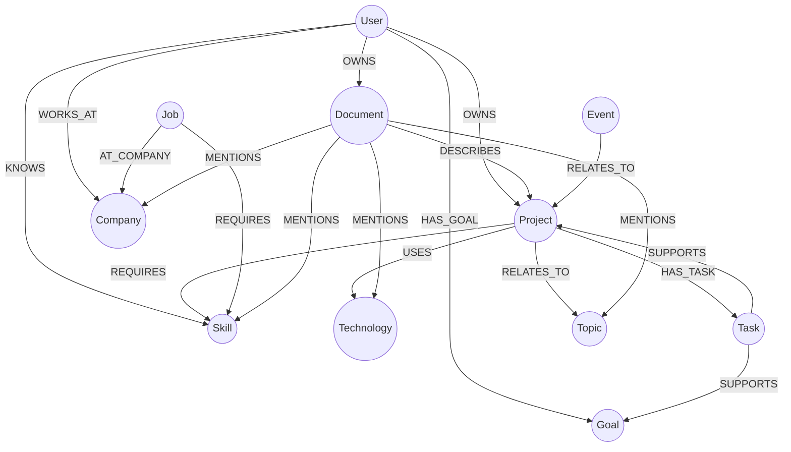

# Knowledge Graph Architecture

> **NEXUS AI — Relational Knowledge Mesh & Graph RAG**

The Knowledge Graph is NEXUS AI's structured relational intelligence layer powered by **Neo4j 5.20 Community**. It models, traverses, and reasons over interconnected personal entities: projects, skills, technologies, documents, tasks, goals, companies, jobs, events, and topics.

---

## 1. Graph Ontology & Entity Relationships

The graph ontology models 11 primary entity types and 10 directed relationship types:



---

## 2. Entities & Node Labels

All nodes carry an indexed `user_id` property guaranteeing strict multi-tenant isolation:

| Entity Label | Core Properties | Description |
|---|---|---|
| `User` | `id`, `name`, `system_user_id`, `email` | Platform user root node |
| `Project` | `id`, `name`, `status`, `description`, `db_id` | User software and engineering projects |
| `Skill` | `id`, `name`, `category`, `proficiency` | Technical, domain, or soft skills |
| `Technology` | `id`, `name`, `category`, `version` | Frameworks, languages, databases, cloud tools |
| `Document` | `id`, `name`, `document_type`, `document_id` | Uploaded knowledge files (PDF, DOCX, etc.) |
| `Task` | `id`, `name`, `status`, `priority`, `db_id` | Actionable tasks and milestones |
| `Goal` | `id`, `name`, `category`, `status`, `progress_pct`| Strategic goals and objectives |
| `Event` | `id`, `name`, `start_time`, `event_type` | Calendar meetings, sprint demos, interviews |
| `Company` | `id`, `name`, `industry` | Organizations, employers, and clients |
| `Job` | `id`, `name`, `company` | Target job openings and career roles |
| `Topic` | `id`, `name`, `category` | High-level engineering domains (AI, DevOps) |

---

## 3. Relationships & Edge Types

Directed relationships support multi-hop Cypher queries and neighborhood subgraphs:

| Relationship | Source Label → Target Label | Semantic Meaning |
|---|---|---|
| `OWNS` | `User` → `Project` / `Document` | User owns a project or file |
| `USES` | `Project` → `Technology` | Project utilizes a technology or library |
| `KNOWS` | `User` → `Skill` | User has proven competency in a skill |
| `REQUIRES` | `Job` / `Project` → `Skill` | Role or project mandates skill proficiency |
| `DESCRIBES` | `Document` → `Project` | Document details a project's architecture |
| `SUPPORTS` | `Task` → `Goal` / `Project` | Task directly drives a milestone or goal |
| `RELATES_TO`| `Event` → `Project` | Meeting or interview connects to a project |
| `HAS_TASK` | `Project` → `Task` | Project contains a task |
| `HAS_GOAL` | `User` → `Goal` | User pursues a strategic objective |
| `WORKS_AT` | `User` → `Company` | User's current or prior organization |

---

## 4. Ingestion & Automated Synchronization

The Knowledge Graph remains automatically synchronized with user activity via two pipelines:

1. **Document Entity Extraction**:
   - When a document is uploaded to the Knowledge Vault, the extractor (`app.services.graph.extractor.GraphEntityExtractor`) scans parsed text using regex patterns and terminology dictionaries.
   - Discovered skills (`Python`, `Docker`, `PostgreSQL`), companies (`Google`, `Stripe`), and technologies are automatically converted into graph nodes and linked with `MENTIONS` edges.
2. **Relational Database Synchronization**:
   - Relational records in PostgreSQL (`projects`, `tasks`, `goals`) automatically sync to Neo4j.
   - For example, creating a project named *"Nexus AI"* with tag *"FastAPI"* creates `(:Project {name: "Nexus AI"})-[:USES]->(:Technology {name: "FastAPI"})`.

---

## 5. Resilient Graph Storage & InMemoryGraphStore Fallback

To support local testing and offline execution when Neo4j is not running:
- The graph client (`app.services.graph.neo4j_client.Neo4jClient`) connects to `bolt://localhost:7687` when available.
- If Neo4j is offline or unreachable, the system automatically falls back to **`InMemoryGraphStore`**.
- `InMemoryGraphStore` provides:
  - Scoped node and edge dictionary indexing `(user_id, label, normalized_name) -> node_id`.
  - Automatic deduplication and node merging.
  - Multi-hop neighborhood lookups and Cypher pattern matching.
  - Zero crashes during local unit tests or offline demonstrations.

---

## 6. Graph-Augmented RAG

When processing complex multi-hop queries, NEXUS combines vector search with graph context:

```cypher
MATCH (u:User {system_user_id: $user_id})-[:OWNS]->(p:Project)-[:USES]->(t:Technology)
MATCH (p)-[:REQUIRES]->(s:Skill)
RETURN p.name, collect(t.name) as technologies, collect(s.name) as skills;
```

The resulting subgraph is serialized into structured markdown and injected into the LLM prompt:

```text
<GRAPH_CONTEXT>
- Project "Nexus AI" uses [FastAPI, PostgreSQL, Neo4j] and requires [Python, System Design].
- Project "Cloud Engine" uses [AWS, Docker, Kubernetes] and requires [Cloud Architecture].
</GRAPH_CONTEXT>
```

This enables the model to answer queries like:
> *"What projects do I have that demonstrate my Kubernetes and Cloud Architecture skills?"*
with zero hallucinations.

---

## 7. Interactive Canvas Force-Directed Explorer (`/knowledge-graph`)

The web frontend features a custom HTML5 Canvas graph explorer:
- **Physics Simulation**: Custom Verlet / force-directed simulation with repulsive node charges, attractive edge springs, and velocity dampening.
- **Node Badges & Directional Arrows**: Color-coded by entity label with directional arrows showing incoming/outgoing edge types.
- **Interactive Controls**: Drag-and-drop nodes, scroll-to-zoom, pan, search by name, and filter by entity type pills.
- **Metadata Drawer**: Clicking any node opens a slide-out inspector detailing properties, incoming relationships, and outgoing connections.
