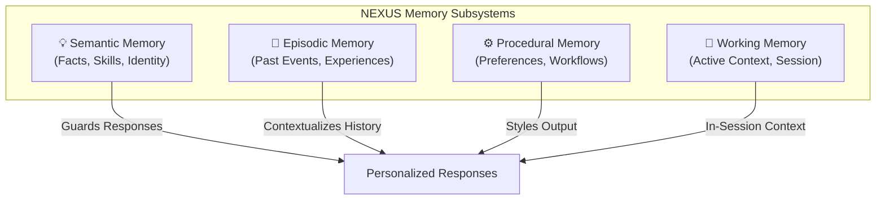
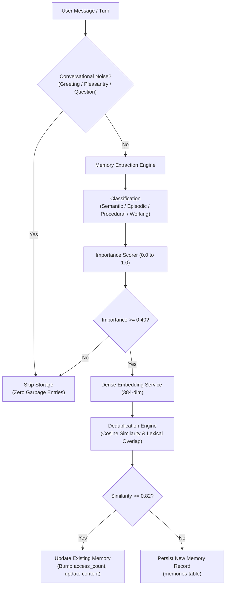

# Personalized AI Memory Architecture

> **NEXUS AI — Phase 3 Cognitive Intelligence Layer**

NEXUS AI incorporates a four-tier cognitive memory architecture inspired by human memory systems. The memory engine automatically extracts meaningful insights from conversations, scores importance, deduplicates and consolidates knowledge, and seamlessly guides AI responses while maintaining strict user privacy.

---

## 1. The Four Memory Types



### 1.1 Semantic Memory (Facts about User)
- **Definition**: Factual knowledge about the user's skills, knowledge, profession, background, and identity.
- **Example**:
  - *"User knows Python and TypeScript."*
  - *"User works as a Principal Cloud Architect specializing in AWS and Kubernetes."*
- **Persistence**: Indefinite; reinforced or updated when new details emerge.

### 1.2 Episodic Memory (Past Events & Milestones)
- **Definition**: Time-indexed experiences, milestones, sessions, and events that occurred in the past.
- **Example**:
  - *"User previously prepared for a software engineering interview at Google."*
  - *"User completed the Phase 1 cloud database migration in 2026."*
- **Persistence**: Long-term with recency weighting.

### 1.3 Procedural Memory (Preferences & Workflows)
- **Definition**: Implicit or explicit user preferences, communication habits, and task execution workflows.
- **Example**:
  - *"User prefers dark mode and concise answers with strict typing."*
  - *"User prefers 90-minute morning deep work blocks with coffee."*
- **Persistence**: Persistent guidelines shaping AI tone and output formatting.

### 1.4 Working Memory (Active Task Context)
- **Definition**: Short-term focus representing current in-flight goals or debugging sessions.
- **Example**:
  - *"User is currently debugging Phase 3 memory deduplication and vector embeddings."*
- **Persistence**: Active session lifecycle.

---

## 2. Memory Processing Pipeline



### 2.1 Noise Filtering
The memory pipeline intentionally rejects non-informative messages:
- Pure greetings (`"Hi"`, `"Hello there!"`)
- Pleasantries (`"Thanks a lot!"`, `"ok"`, `"cool"`)
- Instructional questions without self-statements (`"What is Docker?"`, `"How do I sort a list?"`)

### 2.2 Extraction & Canonicalization
First-person statements are transformed into canonical third-person declarative facts:
- Input: `"I work as a Staff Systems Architect."`
- Extracted: `"User works as a Staff Systems Architect."`

### 2.3 Importance Scoring
- Core technical skills and career roles: $0.85 - 0.95$
- Explicit workflow preferences: $0.75 - 0.85$
- Specific dated events: $0.70 - 0.80$
- General context: $0.50 - 0.65$
- Messages below $0.40$ importance are never stored.

### 2.4 Deduplication & Consolidation
Before inserting, the engine searches existing memories for the user:
- **Cosine similarity $\ge 0.90$**: Exact duplicate. Increments `access_count`, refreshes `last_accessed_at`, takes the maximum importance score, and avoids row duplication.
- **Cosine similarity $0.82 - 0.90$**: High semantic overlap. Refines the existing memory content with new details and updates the embedding vector.
- **Cosine similarity $< 0.82$**: Stored as a novel memory row.

---

## 3. Retrieval & Answer Grounding

When the user asks a question:
$$\text{Query} \to \text{Memory Retrieval} \to \text{Document Retrieval (RAG)} \to \text{Context Construction} \to \text{LLM}$$

### Composite Retrieval Scoring
Memories are retrieved using a composite multi-signal ranking function:
$$\text{Score} = 0.45 \times \text{CosineSim}(\mathbf{q}, \mathbf{m}) + 0.35 \times \text{LexicalOverlap}(q, m) + 0.20 \times \text{Importance}(m)$$

### Privacy & Anti-Leakage Directives
The assistant utilizes remembered knowledge naturally:
- Adapts explanations to known user skills (e.g., provides Python snippets if user knows Python).
- Respects preferences (e.g., concise answers without boilerplate).
- **Does not leak internal implementation details** (avoids phrases like *"According to database memory #1234"*).

---

## 4. Database Schema

The `memories` table is indexed and protected by strict foreign-key cascade constraints:

```sql
CREATE TABLE memories (
    id CHAR(36) PRIMARY KEY,
    user_id CHAR(36) NOT NULL REFERENCES users(id) ON DELETE CASCADE,
    memory_type VARCHAR(32) NOT NULL,
    content TEXT NOT NULL,
    importance FLOAT DEFAULT 0.5 NOT NULL,
    source VARCHAR(64) DEFAULT 'conversation' NOT NULL,
    source_id VARCHAR(255),
    mem_metadata JSON NOT NULL,
    embedding JSON, -- or vector(384) with pgvector
    access_count INTEGER DEFAULT 0 NOT NULL,
    last_accessed_at TIMESTAMP WITH TIME ZONE NOT NULL,
    created_at TIMESTAMP WITH TIME ZONE NOT NULL,
    updated_at TIMESTAMP WITH TIME ZONE NOT NULL
);

CREATE INDEX ix_memories_user_id ON memories (user_id);
CREATE INDEX ix_memories_memory_type ON memories (memory_type);
CREATE INDEX ix_memories_importance ON memories (importance);
```

---

## 5. Memory Management API

| Method | Endpoint | Description |
|---|---|---|
| `GET` | `/api/v1/memories` | List memories with filters (`memory_type`, `search`, `min_importance`) |
| `POST` | `/api/v1/memories` | Manually consolidate new memory (`content`, `memory_type`, `importance`) |
| `GET` | `/api/v1/memories/stats` | Aggregated statistics (total, semantic, episodic, procedural, working, avg importance) |
| `POST` | `/api/v1/memories/extract` | Extract candidate memories from text without persisting |
| `GET` | `/api/v1/memories/{id}` | Retrieve memory detail |
| `PATCH` | `/api/v1/memories/{id}` | Update memory content, type, or importance |
| `DELETE` | `/api/v1/memories/{id}` | Permanently delete memory with strict user isolation |

---

## 6. Frontend UI (`/memory`)

The `/memory` page features:
1. **Interactive Metrics**: Real-time counter cards for Total, Semantic Facts, Episodic Events, Procedural Habits, and Working Context.
2. **Filter Toolbar**: Instant type filtering pills, search bar, and importance threshold selector.
3. **Memory Intelligence Cards**: Visual cards with distinct color-coded badges, importance percentage indicators, entity tags, access metrics, and inline Edit/Delete actions.
4. **Modal Dialogs**: Add and Edit modal for manual memory consolidation and importance tuning.
