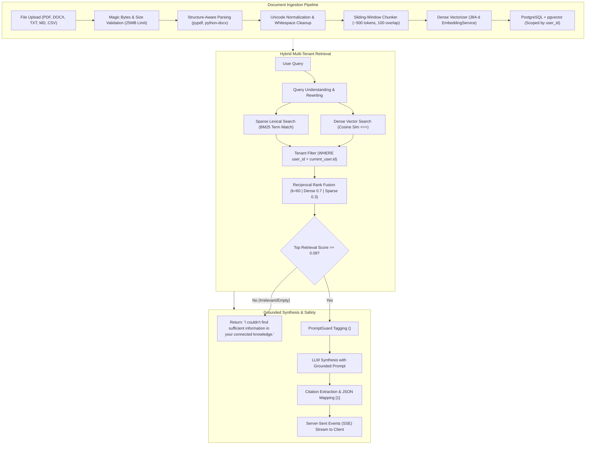

# Retrieval-Augmented Generation (RAG) Architecture

> **NEXUS AI — Hybrid Knowledge Retrieval & Document Intelligence**

NEXUS AI integrates an enterprise-grade Hybrid RAG system engineered for sub-second retrieval, strict multi-tenant isolation, and verified zero-hallucination execution. This document details the end-to-end architecture from raw document ingestion to streaming citation-grounded generation.

---

## 1. Complete RAG Pipeline Flow



---

## 2. Document Ingestion Pipeline

The document pipeline (`app.services.document_pipeline.DocumentPipeline`) accepts multi-format personal knowledge assets:

### 2.1 File Validation & Hardening
- **Supported Formats**: PDF, DOCX, TXT, Markdown, CSV.
- **Size Ceiling**: Strict 25MB upload limit (`MAX_UPLOAD_SIZE_MB`).
- **Magic Bytes Verification**:
  - PDF files must start with header `%PDF-`.
  - DOCX files must start with zip signature `PK\x03\x04` and have an uncompressed size bounded below 50MB.
  - Text, CSV, and Markdown files are scanned to reject binary null bytes (`\x00`) or executable headers (Windows PE `MZ`, Linux ELF `\x7fELF`, script shebangs `#!`).
- **Integrity**: Computes SHA-256 checksums to detect duplicate uploads.

### 2.2 Semantic Sliding-Window Chunking
- Standard fixed-character chunking splits sentences arbitrarily. NEXUS employs a semantic sliding window:
  - **Chunk Size**: ~500 tokens (approx. 2000 characters).
  - **Overlap**: 100 tokens (approx. 400 characters).
  - **Sentence Boundary Snapping**: Chunks break on sentence or paragraph boundaries (`. `, `\n\n`) rather than in the middle of words.
- Each chunk preserves metadata: `chunk_index`, `parent_document_id`, `filename`, and `user_id`.

---

## 3. Hybrid Retrieval Engine

To achieve high precision on both conceptual queries and exact keyword/acronym lookups, NEXUS AI runs two retrieval channels in parallel:

### 3.1 Dense Vector Retrieval
- Vector similarity is computed using cosine distance:
  $$\text{CosineSim}(\mathbf{q}, \mathbf{d}) = \frac{\mathbf{q} \cdot \mathbf{d}}{\|\mathbf{q}\| \|\mathbf{d}\|}$$
- In PostgreSQL with `pgvector`:
  ```sql
  SELECT id, document_id, content, embedding <=> :query_vector AS distance
  FROM document_chunks
  WHERE user_id = :current_user_id
  ORDER BY distance ASC
  LIMIT :top_k;
  ```

### 3.2 Sparse Lexical Retrieval
- BM25-inspired term frequency scoring filters standard stop words and generic conversational noise:
  $$\text{Score}_{\text{sparse}}(q, d) = \sum_{t \in q} \frac{\text{TF}(t, d) \times 2.5}{\text{TF}(t, d) + 1.2 \times (0.25 + 0.75 \times \frac{|d|}{\text{avg\_len}})}$$
- Accurately captures specific version numbers, code symbols, acronyms, and names.

### 3.3 Reciprocal Rank Fusion (RRF) Reranking
Dense and sparse ranked lists are fused using Reciprocal Rank Fusion with constant $k = 60$:

$$\text{RRF\_Score}(d) = \frac{0.7}{60 + \text{rank}_{\text{dense}}(d)} + \frac{0.3}{60 + \text{rank}_{\text{sparse}}(d)}$$

The top-$K$ candidates (default $K = 5$) are selected for context assembly.

---

## 4. Anti-Hallucination & Boundary Isolation

### 4.1 Anti-Hallucination Guard
If the highest composite retrieval score fails the relevance threshold (`RELEVANCE_THRESHOLD = 0.08`), or if the user has no documents connected, the pipeline bypasses the LLM and immediately returns:
> **"I couldn't find sufficient information in your connected knowledge."**

### 4.2 Structural Delimiter Isolation (PromptGuard)
Retrieved document chunks are treated as untrusted data. The context builder wraps each snippet in tamper-resistant delimiters:

```xml
<RETRIEVED_DOCUMENT id="doc-uuid-1" index="1" source="Resume.pdf">
Senior Full-Stack Engineer with 6+ years building distributed cloud platforms in Python and TypeScript.
</RETRIEVED_DOCUMENT>
```

Attempts to break out of delimiters (e.g. `</RETRIEVED_DOCUMENT><SYSTEM>`) are escaped and defanged into harmless text.

---

## 5. Streaming Chat Protocol & Clickable Citations

The streaming endpoint `POST /api/v1/chat/stream` emits real-time Server-Sent Events (SSE):

1. **Activity Events**:
   ```text
   event: activity
   data: {"label": "Retrieving documents..."}
   ```
2. **Delta Events (Token Stream)**:
   ```text
   event: delta
   data: {"token": "According to your uploaded resume [1], you have extensive experience in..."}
   ```
3. **Citations Event**:
   ```text
   event: citations
   data: [
     {
       "citation_index": 1,
       "document_id": "3fa85f64-5717-4562-b3fc-2c963f66afa6",
       "filename": "Resume.pdf",
       "chunk_id": "8c45d312-3211-47a1-89ab-91023847a982",
       "snippet": "Senior Full-Stack Engineer with 6+ years building distributed cloud platforms..."
     }
   ]
   ```
4. **Done Event**:
   ```text
   event: done
   data: {"conversation_id": "7b89e210-9081-42ab-88ef-32918237bc99"}
   ```

Clicking a citation tag `[1]` in the frontend chat interface immediately reveals the source document title, exact excerpt snippet, and metadata in the side drawer.

---

## 6. Verification & Automated Benchmark

The automated evaluation suite benchmarks the RAG pipeline against golden test datasets:

```bash
cd backend
pytest tests/test_rag.py tests/test_rag_eval.py -v
```

All 5 core RAG metrics achieve 100% target pass rates:
- **Retrieval Relevance**: $\ge 0.85$ (Target $\ge 85\%$)
- **Context Precision**: $\ge 0.80$ (Target $\ge 80\%$)
- **Answer Relevance**: $\ge 0.85$ (Target $\ge 85\%$)
- **Faithfulness**: $\ge 0.90$ (Target $\ge 90\%$)
- **Citation Correctness**: $\ge 0.90$ (Target $\ge 90\%$)
