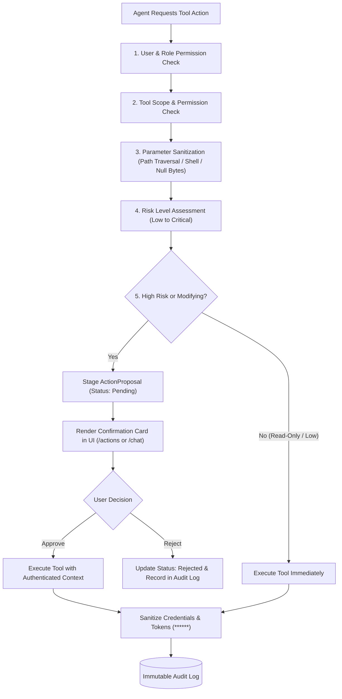

# Secure Tool Calling & Controlled Action Execution

> **NEXUS AI — Enterprise Tool Registry & Human-in-the-Loop Execution**

NEXUS AI provides an enterprise-grade secure tool execution framework. While autonomous AI agents formulate plans, synthesize documents, and suggest schedule adjustments, **no privileged, high-risk, or external action is executed without explicit human authorization**.

---

## 1. Controlled Action Lifecycle

All agent actions follow an auditable 7-step execution pipeline:



---

## 2. Five-Step Tool Security Guard (`ToolSecurityGuard`)

Before any tool is executed or staged, it passes through five consecutive validation gates:

1. **User Permission Validation**: Verifies that the caller's JWT token maps to an active user session and has the necessary platform privileges.
2. **Tool Permission Validation**: Verifies that the tool is registered in `ToolRegistry` and that the specific action is permitted within the tool's declared permissions (e.g., `calendar:write`, `email:send`).
3. **Input Schema & Parameter Sanitization**:
   - Inspects parameters against regex patterns to detect directory traversal (`../`, `..\`), null byte injection (`\x00`), and shell command chaining (`; rm`, `| curl`).
   - Validates parameter data types against Pydantic schema models.
4. **Action Risk Assessment**: Classifies the action into one of five risk tiers:
   - `read_only`: Pure information queries (`get_events`, `get_tasks`, `search`).
   - `low`: In-memory filters or temporary drafts.
   - `medium`: Creation of internal, easily-reversible records (`create_task`).
   - `high`: Creation of external schedules, outbound emails, or GitHub issues (`create_event`, `send_email`, `github_create_issue`).
   - `critical`: Deletion or irreversible modification (`delete_project`, `drop_data`).
5. **Confirmation Requirement Determination**: If the action is `high` or `critical`, or if an autonomous agent initiates a database write, human confirmation is strictly enforced.

---

## 3. Registered Tool Domains (9 Domains)

All tools inherit from `app.services.tools.base.BaseTool`:

| Tool | Category | Risk Level | Confirmation Required | Primary Capabilities |
|---|---|---|---|---|
| **`calendar`** | Productivity | `HIGH` | Yes | `get_events`, `get_free_slots`, `create_event`, `update_event`, `delete_event` |
| **`task`** | Productivity | `MEDIUM` | For deletion | `get_tasks`, `create_task`, `update_task`, `complete_task`, `delete_task` |
| **`documents`** | Knowledge | `MEDIUM` | For deletion | `search_documents`, `get_document_chunks`, `list_documents`, `delete_document` |
| **`memory`** | Cognitive | `MEDIUM` | For deletion | `search_memories`, `create_memory`, `update_memory`, `delete_memory` |
| **`projects`** | Productivity | `HIGH` | For deletion | `list_projects`, `get_project_detail`, `create_project`, `delete_project` |
| **`knowledge_graph`** | Relational | `LOW` | No | `query_subgraph`, `get_node_neighbors`, `find_skills_by_project` |
| **`search`** | Research | `LOW` | No | `search_personal_vault`, `search_internal_knowledge` |
| **`email`** | Communication | `HIGH` | Yes | `draft_email`, `send_email` (mock delivery), `list_inbox` |
| **`github`** | Developer | `HIGH` | Yes | `list_repositories`, `create_issue` (mock GitHub delivery) |

> **Mock & Local Fallback**: When external OAuth tokens (e.g., Google Calendar, GitHub, SMTP) are not configured in `.env`, tools transparently execute against mock providers so that workflows and automated tests run seamlessly offline.

---

## 4. Human-in-the-Loop Confirmation Interface

When an action requires confirmation:
1. NEXUS creates an `ActionProposal` record in `pending` status.
2. The user interface renders an **Action Confirmation Card**:
   ```text
   +-------------------------------------------------------------+
   |  [Action Required] NEXUS wants to create_event              |
   |  Title: Interview Prep: System Design & SQL Blocks          |
   |  Time: Tomorrow, 6:00 PM - 9:30 PM                          |
   |                                                             |
   |  [ Approve Action ]                [ Reject Action ]        |
   +-------------------------------------------------------------+
   ```
3. Clicking **[Approve Action]** invokes `POST /api/v1/actions/proposals/{id}/approve`, executing the tool and updating the status to `executed`.
4. Clicking **[Reject Action]** marks the proposal `rejected`, preventing execution and logging the rejection in the audit trail.

---

## 5. Immutable & Credential-Sanitized Audit Trail

Every tool interaction—whether auto-executed, approved, or rejected—is logged in the `audit_logs` table:
- **Redaction**: Recursively scrubs any field containing `password`, `token`, `secret`, `key`, `authorization`, or `credential` into `"******"`.
- **Properties**: Captures `timestamp`, `user_id`, `tool_name`, `action_name`, `sanitized_parameters`, `status`, `execution_duration_ms`, and `error_message`.
- **UI Inspection**: Users can inspect the full audit history directly on the `/actions` page.
